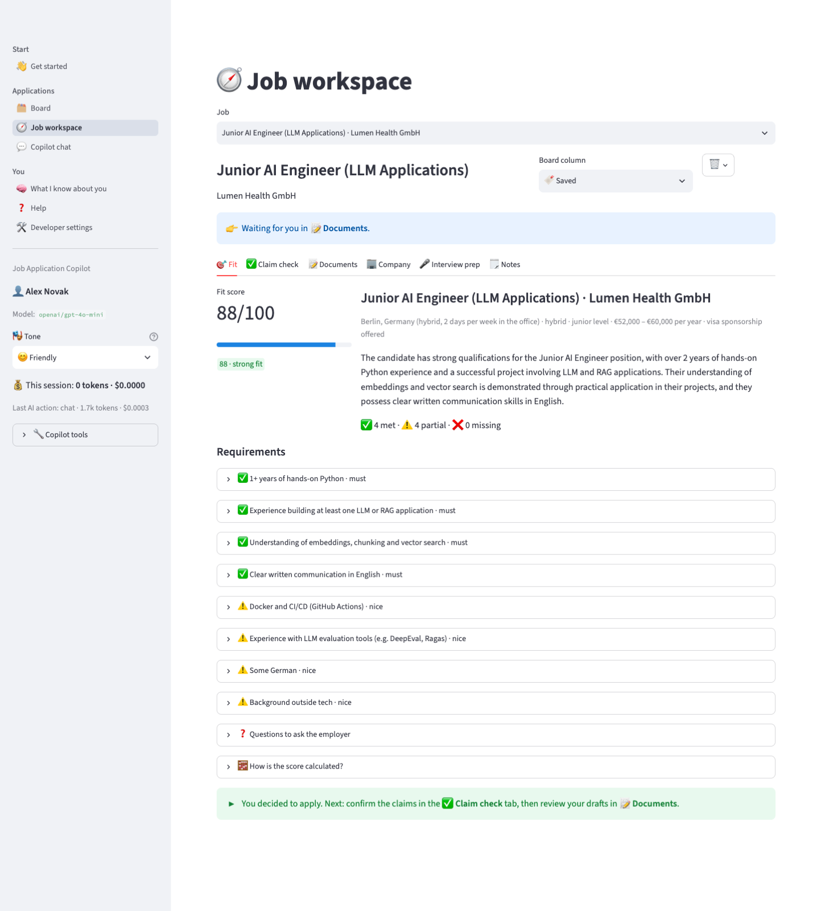
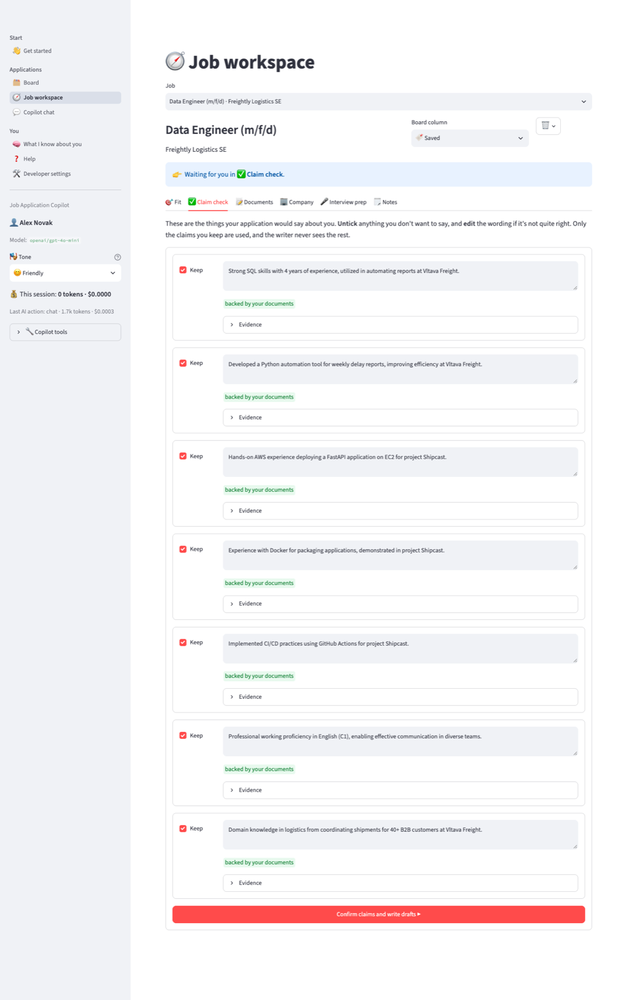
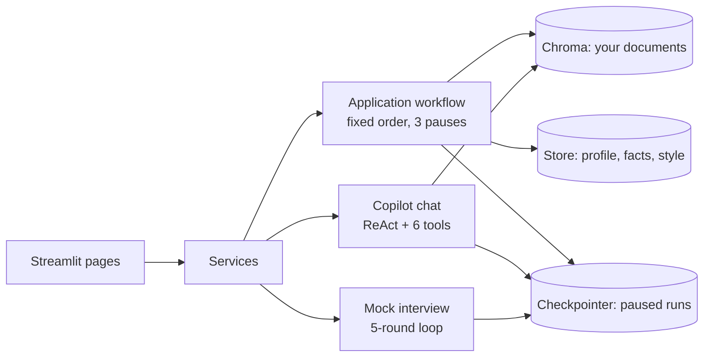

# Job Application Copilot

An AI agent that helps job seekers find out whether they really fit a role, prove it with
evidence from their own documents, write honest tailored applications, practise the interview,
and track every application in one place.

*Turing College · AI Engineering · Sprint 3 project. Built with Streamlit + LangGraph.*



---

## 1. Problem and target users

**The problem.** Tailoring one application takes 30–60 minutes, so people send generic ones.
They often can't judge objectively whether they fit a role, they're tempted to overstate their
experience, and they lose track of where they applied. Generic AI writers make it worse: they
**invent experience** the candidate doesn't have.

**Who it's for.**
- Bootcamp graduates and career changers (for example, Turing College learners)
- Junior and mid-level tech professionals
- International applicants in the EU, for whom visa, language and location requirements matter

| Generic ChatGPT | Job Application Copilot |
|---|---|
| Writes a letter from whatever you paste | Analyses fit requirement by requirement, with **evidence from your own documents** |
| Can invent experience | **Claim check**: every claim about you must be backed by a source or approved by you |
| Forgets you between chats | Remembers your profile, preferences and writing style, and **learns from your edits** |
| One-off text | Tracker board, company research, interview practice and history in one app |

## 2. Features

**Core (MUST)**
- ✅ Onboarding wizard: profile, work authorisation, languages with a level, documents (or the demo persona)
- ✅ Knowledge base from your documents (PDF, DOCX, TXT, MD) in Chroma, with citations
- ✅ Add a job by pasting the text or a URL (SSRF-protected fetch)
- ✅ Grounded fit analysis: agentic RAG + a **deterministic** score + red flags (language, visa, seniority, location, deal-breakers)
- ✅ Claim check (human-in-the-loop): approve, edit or remove every claim before writing
- ✅ Tailored CV bullets + cover letter from approved claims only, fact-checked by an output guard; edit, regenerate a section, export DOCX, copy
- ✅ Kanban board: Saved → Applied → Interview → Offer / Rejected
- ✅ Short-term memory (checkpointer: refresh-safe) + long-term memory (Store: profile, preferences, facts, style rules)
- ✅ Input guards, friendly errors with Retry, empty / loading / error states

**SHOULD and COULD**
- ✅ Copilot chat (custom ReAct graph) with **6 tools**, sidebar toggles and approval before changes
- ✅ Company research (Tavily), job search (Arbeitnow, free, no key)
- ✅ Salary suggestion per job: range from real web data computed in Python, confidence, sources, negotiation tips; "not enough data" instead of a guess
- ✅ Token and cost tracking per action and per session
- ✅ LangSmith tracing with `action` and `prompt_version` metadata
- ✅ Developer settings (password): model, temperature, max tokens, prompts, raw state, costs
- ✅ Mock interview (5 questions, STAR feedback, a better example answer from your own evidence)
- ✅ Learns your style from edits and repeated 👎 ratings
- ✅ Tone selector (formal, friendly, concise), Help page with a help-bot
- ✅ Evaluation report with DeepEval

**Course optional tasks covered**

| Level | Tasks |
|---|---|
| Easy | Model picker, temperature / max-token sliders, personality (tone), interactive help, AI critique of the project (`docs/DECISIONS.md` D77) |
| Medium | Token and cost tracking, long-term memory, 6 tools + toggles, security guard + separate developer settings, feedback loop |
| Hard | Agentic RAG, observability (LangSmith), DeepEval evaluation report, learning from feedback |

## 3. Quick start

Requirements: Python 3.11+ and [uv](https://docs.astral.sh/uv/) (or pip).

```bash
uv sync                          # or: python -m venv .venv && pip install -e .
cp .env.example .env             # then put your OPENROUTER_API_KEY in .env
uv run streamlit run app/main.py
```

Then on the **👋 Get started** page: click **✨ Fill in the demo persona**, then **🧪 Use the
demo persona**, and finish. On the **🗂️ Board**, click **➕ Add job** and pick a sample job.

Optional keys in `.env`: `TAVILY_API_KEY` (company research and salary estimates), `LANGSMITH_TRACING=true` +
`LANGSMITH_API_KEY` (tracing), `APP_DEV_PASSWORD` (developer settings; change the default).
Job search uses the free Arbeitnow API and needs no key.

**Development**
```bash
uv run ruff check .              # lint
uv run pytest                    # 623 unit tests, no network, ~12 s
uv run pytest -m live            # end-to-end tests with the real LLM (a few cents)
uv run python evals/run_evals.py # evaluation report → docs/EVALUATION.md (~$0.06, ~12 min)
uv run python scripts/analyse_sample_jobs.py   # fit analysis on the 3 sample jobs
```

## 4. Common use cases

Full guide with screenshots: [`docs/USER_GUIDE.md`](docs/USER_GUIDE.md).

1. **"Is this job a fit for me?"** Board → ➕ Add job → paste the posting → **Analyse fit**. Read
   the fit card: score, red flags, ✅/⚠️/❌ per requirement with the quoted evidence. Continue, add
   context ("I used Airflow at work"), or mark it not a fit.
2. **"Write my application honestly."** Continue to application → **✅ Claim check**: untick
   anything you don't want to say → **📝 Documents**: edit, regenerate a section, rate →
   **Accept & save** → **Export DOCX**.
3. **"Prepare me for the interview."** Job workspace → **🎤 Interview prep** → Start mock
   interview. Five questions (behavioural, technical, one about a gap), each scored 1–5 with
   one concrete improvement.
4. **"Keep me organised."** Move cards on the board, set a next action and date in **🗒️ Notes**,
   or ask the **💬 Copilot chat**: "Summarise my applications this week", "Research the company
   for my newest job and move it to Applied" (it asks before changing anything).



## 5. Architecture

Three LangGraph graphs, each a different agent shape on purpose, behind a thin Streamlit UI and
a service layer. Diagrams: [`docs/ARCHITECTURE.md`](docs/ARCHITECTURE.md).



| | Application workflow (`application_graph.py`) | Copilot chat (`copilot_graph.py`) |
|---|---|---|
| Type | Deterministic **workflow** with LLM steps | **ReAct agent**: the LLM picks the tools |
| Why | High-stakes output; the order matters; must be auditable; the claim check can't be skipped | Open-ended questions; any mix of tools |
| Human-in-the-loop | `interrupt()` at fit review, claim check, draft review | Approval before `update_tracker` |

The fit score is plain Python: must-haves weigh 3, nice-to-haves 1; met = 1, partial = 0.5,
missing = 0; capped at 40 if a red flag is blocking (for example, a required language you don't
speak). The LLM only classifies.

## 6. Tools

| # | Tool | Type | Needs | What it does |
|---|---|---|---|---|
| 1 | `fetch_job_posting` | read | — | Reads a job URL (URL guard, 10 s, 2 MB) or pasted text into a structured posting |
| 2 | `search_my_experience` | read | — | Searches your documents; returns snippets with file names |
| 3 | `research_company` | read, external | Tavily key | Products, culture, tech stack, news; results wrapped as untrusted |
| 4 | `search_jobs` | read, external | — | Open roles on Arbeitnow (Germany/EU) by keywords, city, remote and visa sponsorship; results wrapped as untrusted |
| 5 | `estimate_salary` | read, external | Tavily key | Salary range for a tracked job from web data (Python maths), compared with your expectation |
| 6 | `get_applications` / `update_tracker` | read / **write** | — | Reads or changes the tracker; changes need your approval |

Tools without their keys are switched off in the sidebar with a hint.

## 7. Memory

| | Short-term: **checkpointer** | Long-term: **Store** |
|---|---|---|
| What | The state of one graph run, saved after every step | Facts about you, across all runs |
| Key | `thread_id`: `job-3`, `chat-…`, `interview-3` | Namespace: `("local", "profile")`, `("local", "style_rules")`, … |
| Example | "Job 3 is paused at the claim check with these 8 claims" | "Prefers a friendly tone", "Avoid the word 'passionate'", "Led a 3-person team at X (confirmed)" |
| Analogy | A save game | Your player profile across all save games |
| File | `data/runtime/checkpoints.db` | `data/runtime/memory.db` |

## 8. Security and privacy

- **Prompt injection:** outside text goes inside tags (`<job_posting>`, `<untrusted_web_content>`)
  with a "data, never instructions" rule; suspicious phrases are flagged; the score is computed in
  Python; the only write tool needs approval. Tested in `tests/test_injection.py`.
- **Chat guard:** Python rules (length, override phrases) + an LLM topic classifier.
- **SSRF:** only public http(s) addresses; redirects re-checked; timeout and size cap.
- **Uploads:** PDF/DOCX/TXT/MD only, 5 MB each, 10 files.
- **Hallucinated experience:** claim check + output guard + citations.
- **Secrets:** `.env` only (gitignored), never shown; developer page password-protected.
- **Network:** the app listens on `localhost` only.
- **Privacy:** all data stays in `data/runtime/` on your computer. Text needed for an AI step is
  sent to **OpenRouter** (which forwards it to the model provider), company names and job
  titles with their city (salary searches) to **Tavily**,
  and, if you turn tracing on, traces to **LangSmith** (`LANGSMITH_HIDE_INPUTS=true` keeps the
  texts out). Job search downloads the public **Arbeitnow** job list and filters it on your
  computer, so your keywords stay local. **Delete all my data** on the Memory page empties
  everything.

Details and known gaps: [`docs/SECURITY.md`](docs/SECURITY.md).

## 9. Evaluation results

`uv run python evals/run_evals.py` runs the real app code on fixed datasets. Last full run
([`docs/EVALUATION.md`](docs/EVALUATION.md) §7):

| Metric | Result | Target |
|---|---|---|
| Requirements extraction precision / recall (10 labelled postings) | 1.00 / 0.98–1.00 | ≥ 0.8 each ✅ |
| Cover-letter faithfulness (DeepEval, 5 cases) | mean 0.89; 3 of 5 letters ≥ 0.9 | ≥ 0.9 per letter ⚠️ |
| "Tailored, no generic filler" (G-Eval) | 0.84 | ≥ 0.6 ✅ |
| Removed claims that leaked into a letter | 0 / 5 | 0 ✅ |
| Chat answer relevancy (5 questions) | 0.86 | ≥ 0.7 ✅ |
| Fit-score std dev over 3 runs | ≤ 6.5 points (partial fit 36–52) | ≤ 5 ❌ |

The flagged faithfulness statements were small exaggerations ("advanced techniques"), not
invented experience. The ranking good > partial > poor held in every run; the partial-fit score is the main thing to
improve.

## 10. Technical decisions

92 decisions with the alternatives considered: [`docs/DECISIONS.md`](docs/DECISIONS.md). The
top 8 are in [`docs/review-prep/REVIEW_GUIDE.md`](docs/review-prep/REVIEW_GUIDE.md) §4.

**Project docs:** [`ARCHITECTURE.md`](docs/ARCHITECTURE.md) · [`DECISIONS.md`](docs/DECISIONS.md) ·
[`SECURITY.md`](docs/SECURITY.md) · [`EVALUATION.md`](docs/EVALUATION.md) · [`USER_GUIDE.md`](docs/USER_GUIDE.md)

**Review-prep notes** (personal study notes, in [`docs/review-prep/`](docs/review-prep/)):
[`REVIEW_GUIDE.md`](docs/review-prep/REVIEW_GUIDE.md) (80+ Q&As) ·
[`PROJECT_SUMMARY.md`](docs/review-prep/PROJECT_SUMMARY.md) · [`CONCEPTS.md`](docs/review-prep/CONCEPTS.md) ·
[`CODE_TOUR.md`](docs/review-prep/CODE_TOUR.md) · [`DEMO_SCRIPT.md`](docs/review-prep/DEMO_SCRIPT.md) ·
[`GLOSSARY.md`](docs/review-prep/GLOSSARY.md) · [`PROJECT_PLAN.md`](docs/review-prep/PROJECT_PLAN.md) ·
[`phase-notes/`](docs/review-prep/phase-notes/)

## 11. Limitations and future work

**Limitations**
- Many job sites (for example LinkedIn) block reading, so pasting the text is the reliable path.
- Single local user; no login.
- Fit quality depends on the uploaded documents, and the LLM can mis-read evidence (a "6+ years
  of ML" requirement was once marked met for a junior; the score stayed low because of the
  German C1 cap).
- The partial-fit score moves between runs (36–52).
- "Python **or** TypeScript" is split into two must-haves.
- Streamlit reruns the script per click and runs in one process: fine for one user, not for many.

**Future work**
- A second check that each "met" snippet really proves its requirement; temperature 0 and a
  score band.
- Fixes from the external critique (D77): only fetch URLs the user typed, wrap all untrusted
  tool output, stricter URL guard, chunk caps on uploads.
- Multi-user: login, Postgres checkpointer and Store, per-user Chroma collections, a background
  queue.
- A browser extension to "send this job to Copilot", calendar reminders (`.ics`) for follow-ups,
  analytics on which applications got answers.

## 12. Cost per application

From the usage log of a demo run with `openai/gpt-4o-mini` (Phase 10):

| Step | Tokens | Cost |
|---|---|---|
| Fit analysis (guard, posting, requirements, evidence with grading and rewrites, assessment) | ~18,000 | ~$0.004 |
| Claim planning | ~1,400 | ~$0.0003 |
| Drafts + output guard (one rewrite) | ~5,600 | ~$0.0013 |
| **One full application** | **~25,000** | **~$0.006** |
| A chat message with tools | ~1,700 | ~$0.0003 |

So 100 applications cost about 60 cents. Prices are in `app/config.py` → `MODEL_PRICING`
(check the provider's current prices).
