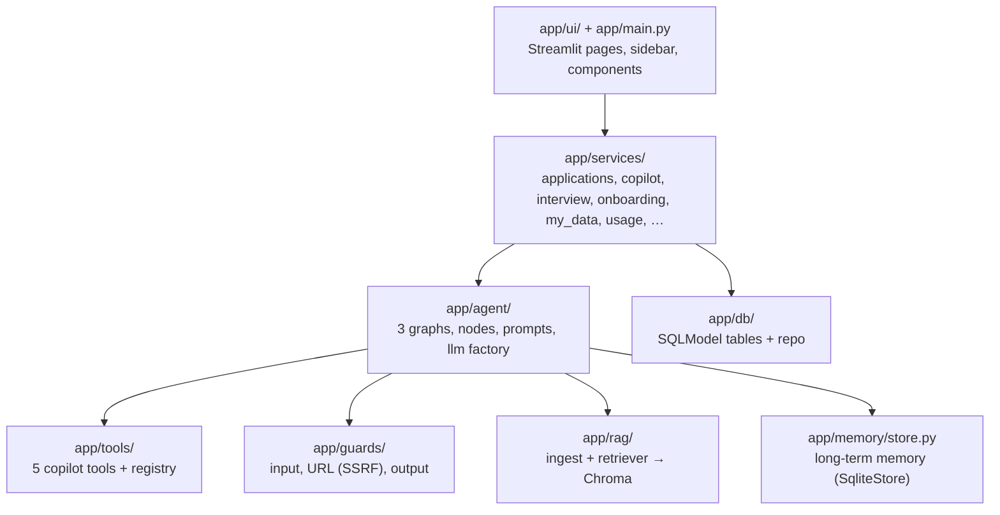
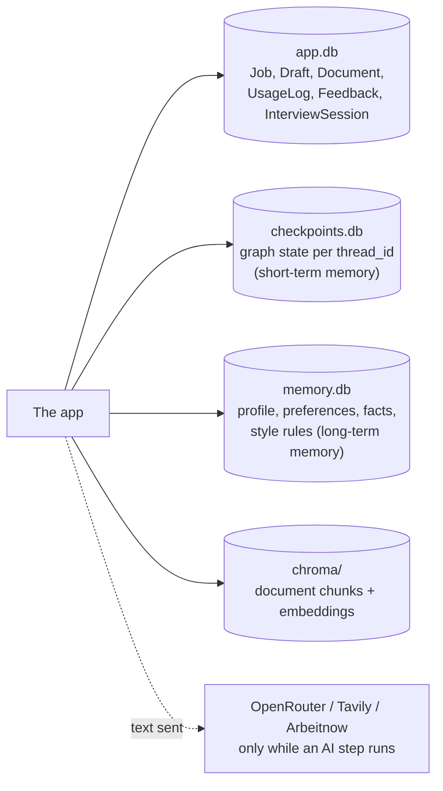
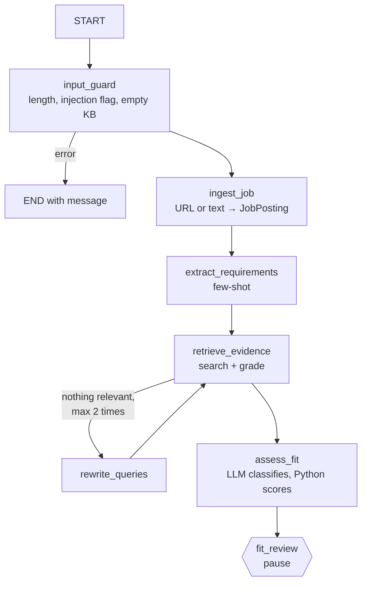
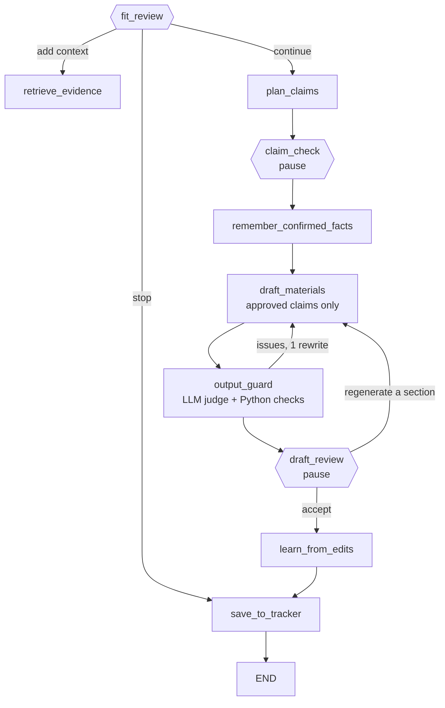
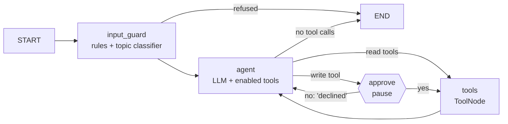
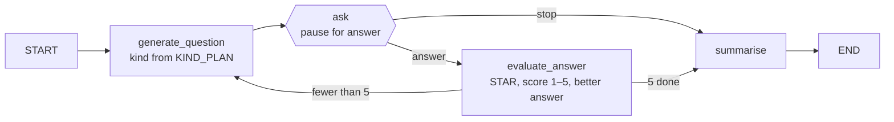
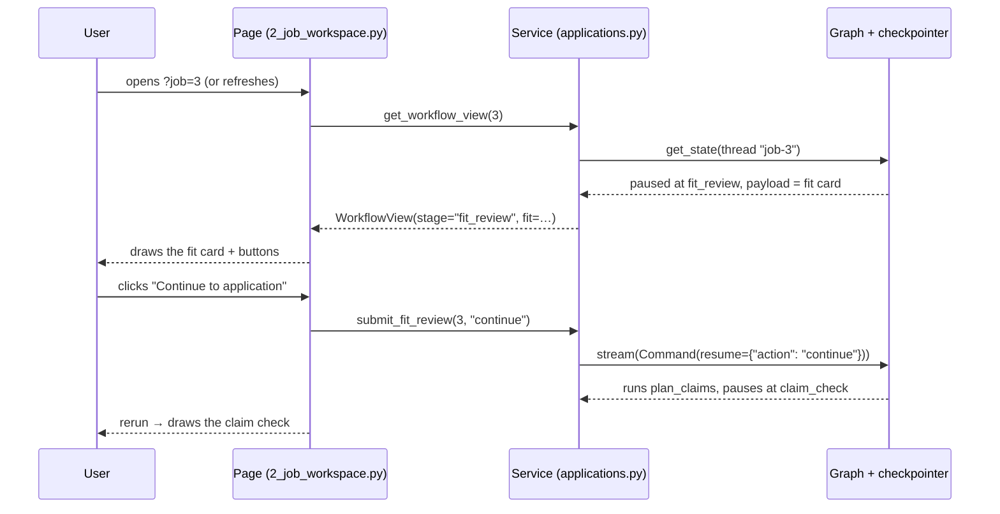

# Architecture

How the app is built, in diagrams. Each diagram has 10 boxes or fewer. For the "why" behind
each choice, see [`DECISIONS.md`](DECISIONS.md); for the concepts, see
[`review-prep/CONCEPTS.md`](review-prep/CONCEPTS.md); to follow one request through the code, see
[`review-prep/CODE_TOUR.md`](review-prep/CODE_TOUR.md).

---

## 1. The layers

**One sentence:** the code is split into layers, and each layer only calls the layers below it.

**Analogy:** a restaurant. The pages are the waiters (they talk to the guest), the services are
the head chef (they decide what happens), the graphs and tools are the cooks, and the database,
Chroma and the Store are the pantry. A waiter never walks into the pantry.

| Layer | Folder | Rule |
|---|---|---|
| UI | `app/ui/`, `app/main.py` | Draws widgets and calls services. Never calls the LLM or the database. |
| Services | `app/services/` | One function per user action (`add_job`, `submit_fit_review`, `send_message`). Wraps runs in cost tracking and turns errors into friendly messages. |
| Agent | `app/agent/` | The three LangGraph graphs and their nodes. All prompts in `prompts.py`; every LLM call through `llm.py`. |
| Tools | `app/tools/` | The copilot's tools. `registry.py` lists them for the toggles. |
| Guards | `app/guards/` | Input checks, URL checks, unsupported-claim checks. |
| Data | `app/rag/`, `app/memory/`, `app/db/` | Chroma (documents), the Store (facts about the user), SQLite (jobs, drafts, usage). |

Nodes get their services (LLM, retriever, Store, database) through `GraphDeps`
(`app/agent/deps.py`), so tests can swap in fakes without a network (D14).

---

## 2. Where data lives

Everything is on the user's computer, in `data/runtime/` (gitignored).

| Store | File | Example content |
|---|---|---|
| App database | `app.db` | Job #3 "Junior AI Engineer", status `applied`, fit 88 |
| Checkpointer | `checkpoints.db` | thread `job-3` is paused at `claim_check` with 8 claims |
| Long-term memory | `memory.db` | `("local", "style_rules")` → "Avoid the word 'passionate'" |
| Vector store | `chroma/` | chunk `alex_novak_cv.md#3`: "Built DocuMind, a RAG chatbot…" |
| Developer overrides | `dev_settings.json` | `{"default_model": "openai/gpt-4.1-mini", "temperature": 0.2, "max_tokens": 2000}` |
| Log | `app.log` | errors with the job or thread id, never shown to the user |

---

## 3. The three graphs

The app uses three different agent shapes on purpose. Each fits its job.

| | Application workflow | Copilot chat | Mock interview |
|---|---|---|---|
| File | `app/agent/application_graph.py` | `app/agent/copilot_graph.py` | `app/agent/interview_graph.py` |
| Shape | Workflow (fixed order) | ReAct agent (LLM picks tools) | Loop (5 rounds) |
| Who picks the next step | Our edges | The LLM's tool calls | Our edges + a counter |
| Pauses (`interrupt()`) | fit_review, claim_check, draft_review | tool_approval | one per question |
| Thread id | `job-<id>` | `chat-<uuid>` | `interview-<job id>` |
| Why this shape | High stakes; must be auditable; nothing may skip the claim check | Open questions; any mix of tools | The same round repeats |

All three are compiled with the same SQLite checkpointer, so every pause survives a browser
refresh and an app restart.

### 3.1 Application workflow graph (the core)

15 nodes in the code. To keep the diagram readable, the analysis half and the writing half are
drawn separately.

**Analysis half** (from "Add job" to the fit card):

`ingest_job` and `extract_requirements` also stop at END with a friendly message if something is
wrong (unreadable link, not a job posting). That is the `_stop_on_errors` edge rule.

**Writing half** (from the user's "Continue" to the saved application):

The routing functions are small and named after the decision: `_after_retrieval`,
`_after_fit_review`, `_after_guard`, `_after_draft_review` in `application_graph.py`.

### 3.2 Copilot chat agent (ReAct)

- Tools are bound on every call from the sidebar toggles (`llm.bind_tools(enabled)`).
- `recursion_limit = 12` steps per message (`chat_config()`).
- The system prompt carries today's date, the tone, the enabled tool names and the user profile.

### 3.3 Mock interview loop

---

## 4. The Streamlit + `interrupt()` pattern

Streamlit reruns the whole page script on every click, so the page can't hold the workflow in
memory. The checkpointer holds it instead.

---

## 5. The tools

| # | Tool (LLM name) | Type | Needs | File |
|---|---|---|---|---|
| 1 | `fetch_job_posting` | read | — | `app/tools/job_posting.py` |
| 2 | `search_my_experience` | read | — | `app/tools/experience.py` |
| 3 | `research_company` | read, external | `TAVILY_API_KEY` | `app/tools/company.py` |
| 4 | `search_jobs` | read, external | — (Arbeitnow, free) | `app/tools/job_search.py` |
| 5 | `estimate_salary` | read, external | `TAVILY_API_KEY` | `app/tools/salary.py` |
| 6 | `get_applications` / `update_tracker` | read / **write** (approval) | — | `app/tools/tracker.py` |

`app/tools/registry.py` → `TOOL_REGISTRY` holds a label, a default, the required keys and the
calls that need approval for each tool. A tool with missing keys is shown off and disabled.

---

## 6. Cross-cutting pieces

| Concern | Where | How |
|---|---|---|
| LLM access | `app/agent/llm.py` | `get_llm()` builds a `ChatOpenAI` pointed at OpenRouter; `invoke_structured()` adds retries and one schema retry |
| Prompts | `app/agent/prompts.py` | All prompts and tool descriptions, `PROMPT_VERSION`, `wrap()` for delimiters |
| Cost | `app/services/usage.py` | `track_usage(action)` counts tokens of every LLM call inside it → `UsageLog` |
| Tracing | `app/services/observability.py` | `track_run(action)` = cost tracking + LangSmith tags and metadata |
| Errors | `app/utils/errors.py` | `AppError` subclasses with a `user_message`; `friendly_message()` for unknown errors |
| Logging | `app/utils/logging.py` | `data/runtime/app.log`, with job and thread ids |
| Settings | `app/config.py` | `Settings` (pydantic-settings) + developer overrides + `MODEL_PRICING` |
