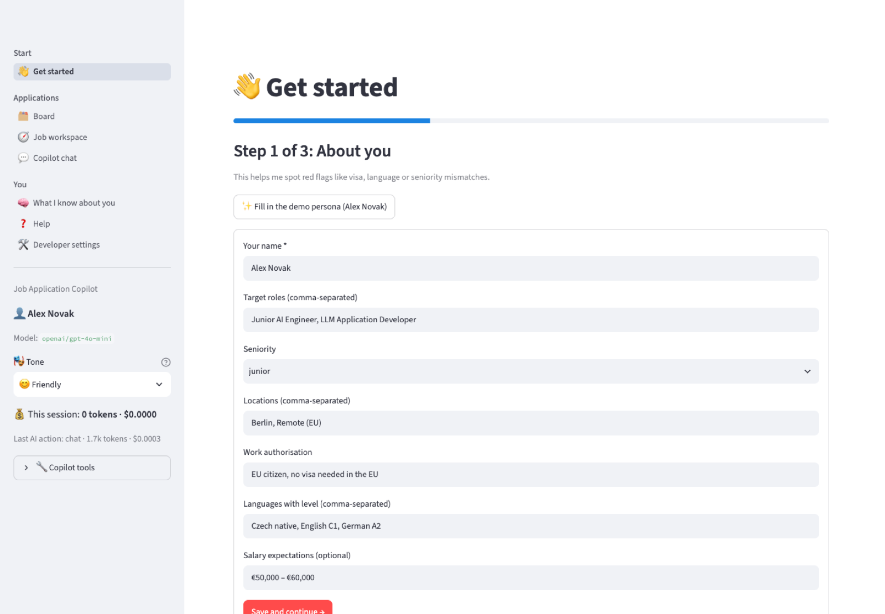
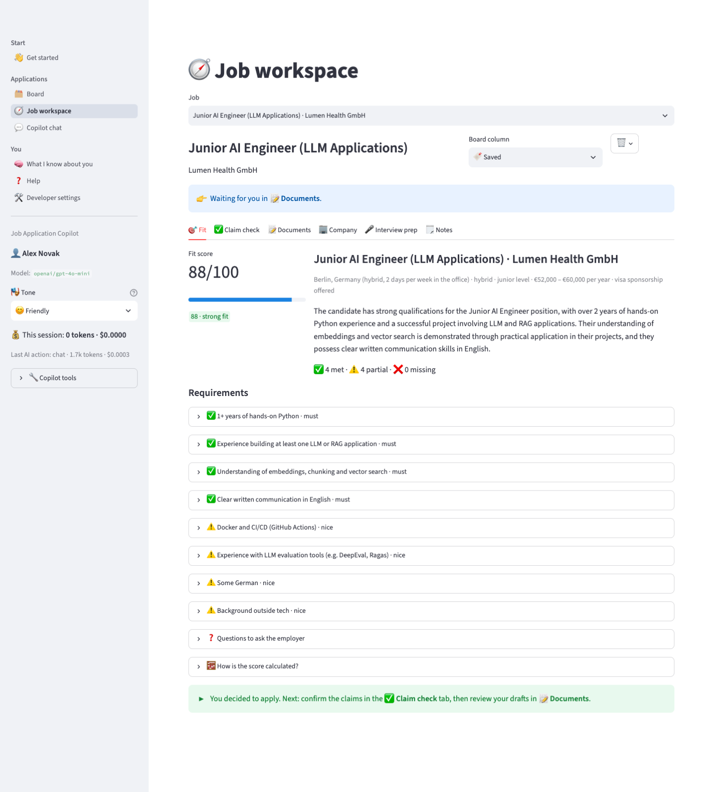
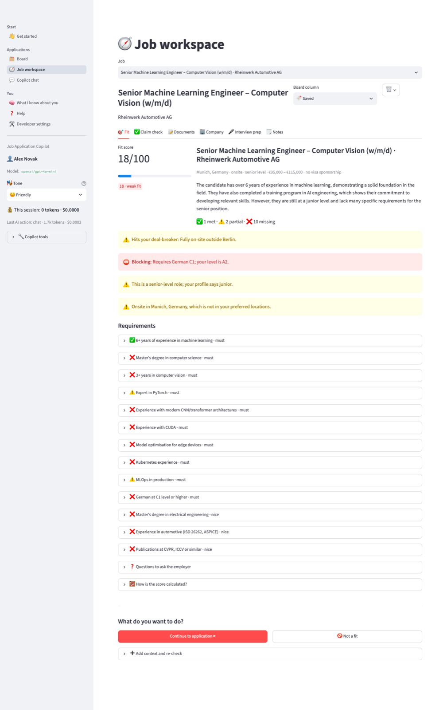
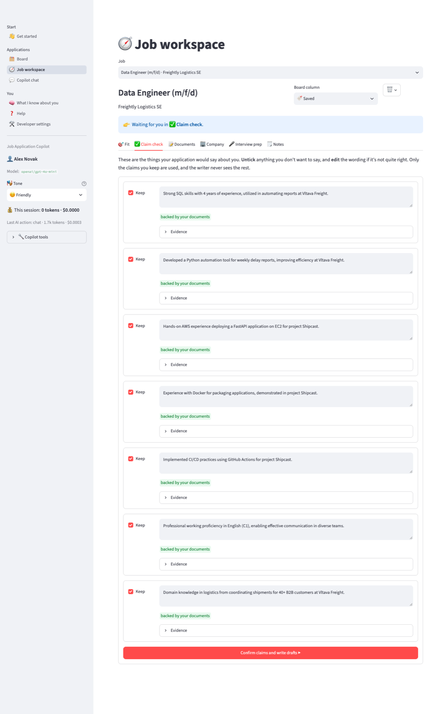
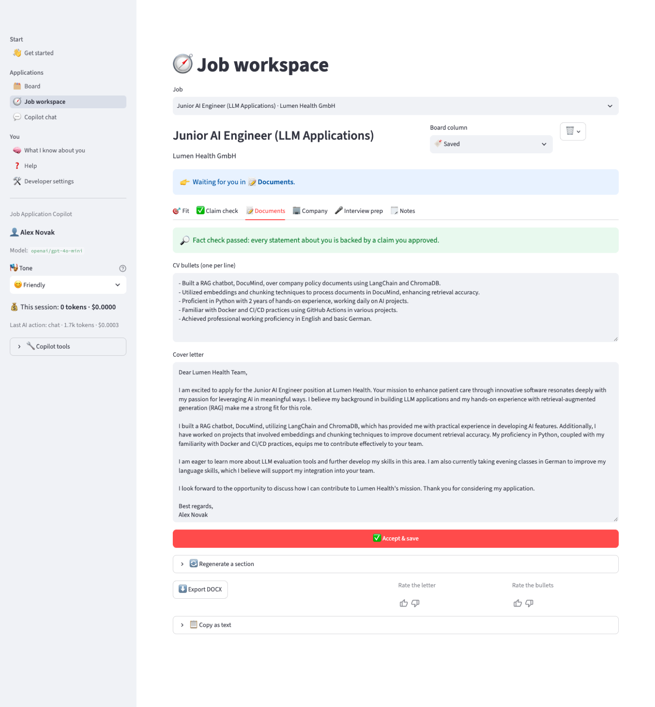
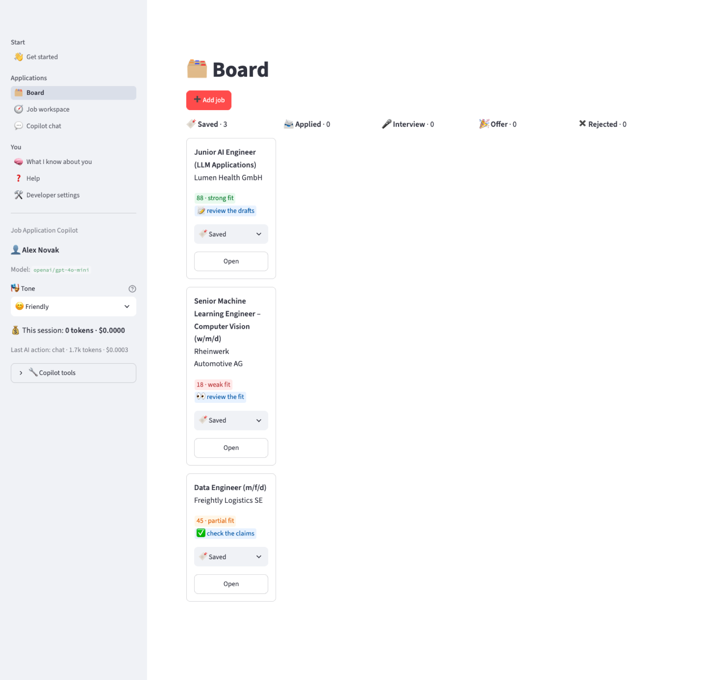
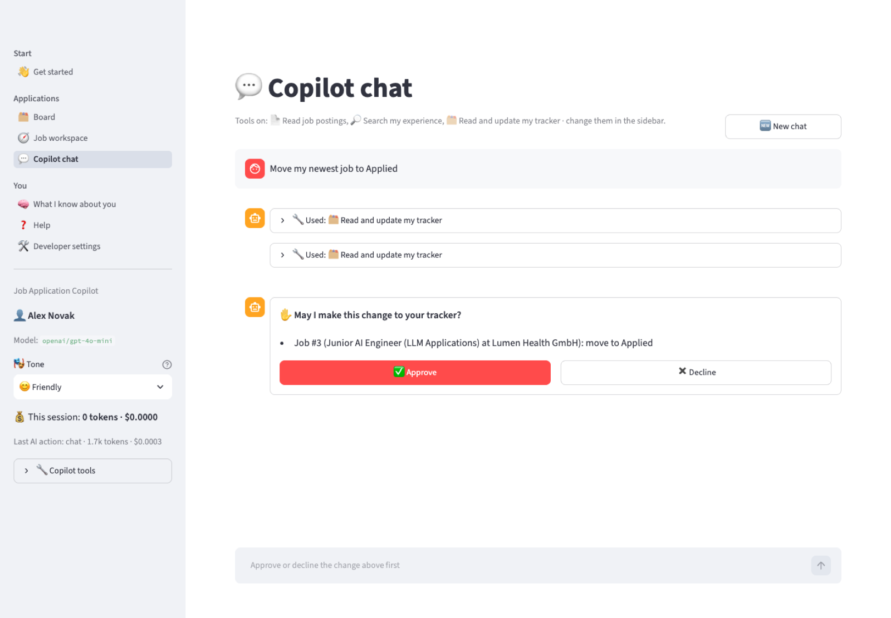
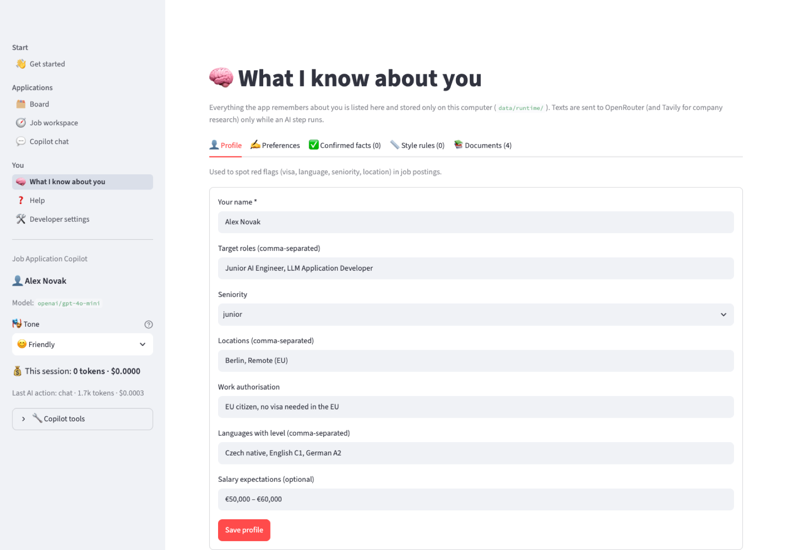

# User guide

Job Application Copilot helps you find out whether you really fit a job, prove it with
evidence from your own documents, write an honest application, practise the interview, and
keep track of every application. This guide is also what the help-bot on the **❓ Help** page
answers from.

> Screenshots show the fictional demo persona, Alex Novak. They live in `docs/assets/`.

## Getting started

1. Start the app with `uv run streamlit run app/main.py`. It opens in your browser.
2. The **👋 Get started** page asks three things:
   - **Profile**: your name, target roles, seniority, locations, work authorisation and
     languages with a level (for example "German A2"). The app uses these to spot red flags
     such as a required language or visa sponsorship.
   - **Documents**: upload your CV, project READMEs, a brag document or past cover letters
     (PDF, DOCX, TXT or MD; up to 10 files, 5 MB each). Or click **Use the demo persona** to
     try the app with the fictional "Alex Novak".
   - **Preferences**: tone (formal, friendly or concise), cover letter length, the language
     of your letters, and deal-breakers (for example "no relocation").
3. When it says "Your knowledge base: … chunks from … documents ✔", you're ready.

You need an OpenRouter API key in the `.env` file (`OPENROUTER_API_KEY`). Without it you can
browse saved data, but AI features don't run, and a banner explains what to do.

## Use case 1: "Is this job a fit for me?"

1. Go to **🗂️ Board** and click **➕ Add job**.
2. Paste the job ad's text, or its link. Many sites (LinkedIn, for example) block reading,
   so pasting the text is the most reliable way. You can also pick a sample job.
3. Click **Analyse fit**. A progress box shows each step: reading the posting, extracting the
   requirements, searching your documents, scoring. Its header always says which step runs
   (for example "(3/5) Extracting the requirements…"), even when the box is closed.
   If the posting doesn't name the company, the card says "Unknown company"; set the real name
   with **✏️** next to the job title in the Job workspace.
4. The **🎯 Fit** tab of the **Job workspace** shows the **fit card**:
   - a **score from 0 to 100**,
   - **red flags** such as "German C1 required" (a blocking flag caps the score at 40),
   - the **requirements**: first a summary (**Must-have met: X / Y** and how many are met,
     partial and missing), then the requirements grouped by status. **❌ Missing** and
     **⚠️ Partial** are open, **✅ Met** is closed. Use **All / Gaps only / Must-have only** to
     filter. Each row shows the requirement, MUST or nice, and one sentence why; click
     **📄 Evidence**, **💡 Tip** or **📄 Details** for the quotes from your documents and a tip on
     how to address a gap honestly.
5. Then choose:
   - **Continue to application ▶** to write the application,
   - **➕ Add context and re-check** if you have experience your documents don't mention
     (for example "I used Airflow at my last job"),
   - **🚫 Not a fit** to stop. The job stays on the board.

A poor fit looks like this: a **blocking** red flag (German C1 required, the profile says A2) keeps
the score low, and the deal-breaker and seniority warnings are listed too.

**How is the score calculated?** Must-have requirements weigh 3, nice-to-haves 1. Met counts
fully, partial half, missing zero. The AI only decides met / partial / missing; the arithmetic
is plain Python, so the same assessment always gives the same score.

## Use case 2: "Write my application honestly"

1. After **Continue to application**, open the **✅ Claim check** tab. It lists the claims your
   application would make about you, for example "Built a RAG chatbot with LangChain".
2. **⚠️ Needs your confirmation** comes first: no document mentions these claims, so they start
   unticked. Tick one only if it's true; the app then remembers it as a fact you confirmed.
   **✅ Backed by your documents** are ticked; click **📄 N sources** to see the quotes.
3. Untick what you don't want to say (it gets struck through), click **✏️** to change the
   wording (then **Save**), or use **Keep all backed** / **Untick unconfirmed**. Then click
   **✍️ Write my application →**. The writer only ever sees the claims you kept.

4. The **📝 Documents** tab shows your **CV bullets** and **cover letter**. A fact-checker
   marks any statement it couldn't match to an approved claim.
5. Edit the texts directly. The cover letter is split into parts: the recipient (company,
   department, city), the subject, the salutation, one box per paragraph and the
   closing. Empty a paragraph to remove it, or write one in **Add a paragraph**. Next to it, a
   white **preview** shows the letter exactly as the PDF will look. Your name, email, phone,
   LinkedIn and city at the top come from your profile (**🧠 Memory → Profile**). Or use
   **🔄 Regenerate a section** with an instruction like "shorter" or "more about the RAG
   project". Your edits to the other section are kept.
6. Click **✅ Accept & save**. Every version is saved; see them in the **🗒️ Notes** tab.
7. **⬇️ PDF** downloads the letter as a one-page A4 PDF, ready to send. **⬇️ Word (.docx)**
   gives the same layout to edit in Word. The files are named like
   `CoverLetter_Alex_Novak_LumenHealth.pdf`. **📋 Copy as text** shows the CV bullets and the
   letter as plain text.
8. Rate the letter and the bullets with 👍 or 👎. After a 👎 you can say what was wrong.

## Learning your writing style

The app learns from your edits. If you delete "passionate" from a letter and click **Accept
& save** (or **💾 Save changes** later), it may learn the rule "Avoid the word 'passionate'"
and shows "🧠 I learned: …" with an **↩️ Undo** button.

- Learned rules go into every new letter. Banned words are also checked by the fact-checker,
  so a new draft that uses one is rewritten once, then highlighted.
- It only learns general style (word choice, sentence length, tone), never facts about one job.
- If two or more 👎 ratings say the same thing ("too long", "too formal"), that becomes a rule
  too.
- See, edit, add or delete rules on **🧠 What I know about you → 📏 Style rules**.

## Use case 3: "Prepare me for the interview"

1. Open the job's **🎤 Interview prep** tab. It needs a finished fit analysis.
2. Click **🎤 Start mock interview**. You get **5 questions**: behavioural ones ("Tell me about
   a time…"), technical ones about the job's must-have skills, and one about a gap the fit
   analysis found. If you researched the company, the questions use that too.
3. Type your answer and click **Send answer**. For each answer you get:
   - a **score from 1 to 5**,
   - which **STAR** parts it had (Situation, Task, Action, Result),
   - comments on relevance and specificity,
   - **one concrete improvement**,
   - an **improved example answer** built only from your answer and your own documents.
4. **End interview now** stops early and summarises the answers so far.
5. At the end you see your **average score**, your strongest and **weakest areas**, and next
   steps to prepare. Past interviews are listed below. **🔁 Start again** begins a new one.

A refresh or restart keeps your place: you return to the same question.

## Use case 4: "Keep me organised"

- The **🗂️ Board** has five columns: Saved, Applied, Interview, Offer and Rejected. Change a
  job's column with the select box on its card or in the workspace.
- The **🗒️ Notes** tab holds notes, a **next action** and a due date (shown on the card).
- The **🏢 Company** tab researches the employer on the web (needs a Tavily key): products,
  tech stack, culture, news and talking points, with links to the sources.
- The **💬 Copilot chat** answers questions such as "Summarise my applications this week" or
  "What should I apply to next?". It can search your documents, research companies, find job
  ads (Arbeitnow, mostly Germany and the EU; no key needed), estimate salaries and read or
  update your tracker. Before it **changes** your tracker,
  it asks for your approval. Click **New chat** to start over.
- Switch the copilot's tools on or off under **🔧 Copilot tools** in the sidebar.

## Use case 5: "What salary should I ask for?"

1. Open a job that has a finished fit analysis and click the **💰 Salary** tab. It needs a
   Tavily key (`TAVILY_API_KEY`), like company research.
2. Click **💰 Estimate salary**. The app searches the web for salaries of similar roles in the
   job's city (for jobs in Germany also the Bundesagentur für Arbeit's **Entgeltatlas**), takes
   the figures it finds and computes a range. It takes about 15 seconds.
3. You see:
   - the **range** per year, gross: low (25th percentile), **typical** (median) and high
     (75th percentile), in euros,
   - a **confidence** badge (high / medium / low) based on how many figures match this role,
     place and level,
   - what the **posting** itself says about pay, if anything,
   - how your **expected salary** compares (below / within / above). Set it on the
     **🧠 Memory** page under your profile,
   - what pushes the pay **up** and **down** for this job, and 2–3 honest **negotiation tips**,
   - **Sources and data points**: every figure used, with a link to where it came from, and
     the figures that were dropped and why.
4. If there isn't enough data, you see **"Not enough data"** instead of a made-up number.
   Try **🔄 Refresh** later, look the role up in the
   [Entgeltatlas](https://web.arbeitsagentur.de/entgeltatlas/), or ask the recruiter for the
   salary band.
5. The estimate is saved for the job: the board card shows a **💰 €52k–61k** badge, and the
   tab doesn't search again until you click **🔄 Refresh**.
6. In the **💬 Copilot chat** you can ask "What salary should I ask for at Lumen Health?". The
   copilot finds the job on your board and uses the same estimate.

It's an **estimate only, not financial advice**. Figures from the web can be out of date or
for slightly different roles; check the sources.

## Tone

The **🎭 Tone** selector in the sidebar sets how the app writes for you:

- **Formal**: polite, no contractions, no exclamation marks.
- **Friendly**: warm and natural (the default).
- **Concise**: short sentences, no filler.

It applies to new cover letters, the copilot chat, the interview coach's feedback and this
help-bot. You can also change it on the Memory page under **✍️ Preferences**.

## What the app remembers, and privacy

- **🧠 What I know about you** shows your profile, preferences, confirmed facts, style rules
  and documents. Edit or delete any of them.

- **Delete all my data** (type DELETE to confirm) removes everything: profile, memories,
  documents, jobs, drafts, chats, interviews, usage history and the log.
- All data is stored only on your computer, in `data/runtime/`. Texts are sent to OpenRouter
  (the AI service), and to Tavily for company research, only while an AI step runs.

## Costs

The sidebar shows **💰 This session: … tokens · $…** and the last AI action. A fit analysis
costs about $0.003 with the default model. If a session uses a lot of tokens, a warning
appears.

## Troubleshooting

- **"I can't reach the AI service"**: check your internet connection, then click **🔁 Retry**.
  Your progress is saved; Retry continues from the last finished step.
- **"OpenRouter rejected the API key"**: check `OPENROUTER_API_KEY` in `.env` and restart.
- **"I couldn't read that page"**: paste the job text instead of the link.
- **The fit analysis is blocked**: upload documents first, or use the demo persona.
- **No evidence for any requirement**: your documents may not mention it; use **Add context**
  or upload more documents.
- **The chat refuses my question**: it only helps with your job search.
- **"Sorry, I couldn't build the PDF"**: download the letter as **.txt** instead (the button
  changes) and paste it into your own template. The details are in `data/runtime/app.log`.

## FAQ

**Will the app invent experience?** No. Drafts may only use claims you approved at the claim
check, and a fact-checker looks for anything else.

**Does it apply to jobs or email recruiters for me?** No. It prepares your application; you
send it.

**Can I use it in German?** Set **Language of letters** in your preferences, or leave "Same as
the job posting".

**Where do I change the AI model?** On the password-protected **🛠️ Developer settings** page.
