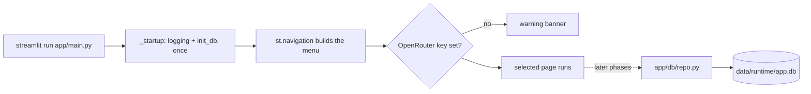

# Phase 1: Foundation

## What I built (plain English, 3–5 sentences)
I set up the project skeleton that every later phase builds on. There is a settings module that
reads API keys and model choices from `.env`, a database with tables for jobs, drafts, documents,
usage, feedback and interviews, and a small set of tested functions to read and write them. There
is one function, `get_llm()`, that creates the chat model through OpenRouter. The Streamlit app starts, shows a
sidebar menu with all seven planned pages (as placeholders for now) and warns if the API key is
missing. I also wrote a fictional demo persona, "Alex Novak", and three sample job postings.

## Why it matters for the user
Nothing is visible yet beyond the menu, but this phase decides that the user's data stays on their
own computer (`data/runtime/`), that secrets never sit in the code, and that the app still opens
without an API key. The demo persona lets anyone try the app without uploading their own CV.

## Concepts used
No agent concepts yet. This phase is about software foundations:
- **Typed configuration**: settings are a Pydantic class, so a wrong type fails at startup, not
  halfway through a request.
  *Analogy:* a checklist at the airport gate, where problems are caught before take-off.
  *Code:* `app/config.py` → `Settings`, `get_settings()`.
- **ORM and repository layer**: tables are Python classes, and all queries live in one module.
  *Analogy:* a librarian. You ask for "all jobs I applied to" and don't walk into the archive yourself.
  *Code:* `app/db/models.py` → `Job`; `app/db/repo.py` → `create_job()`, `update_job()`.
- **Friendly errors**: our own exception types carry a message that is safe to show the user.
  *Code:* `app/utils/errors.py` → `AppError.user_message`, `friendly_message()`.

## Files created or changed
| File | Purpose |
|---|---|
| `pyproject.toml` | Dependencies, ruff and pytest settings, tells the build that the package is `app/` |
| `.env.example` | Template for secrets and settings; copy to `.env` |
| `.gitignore` | Keeps `.env`, `data/runtime/` and caches out of git |
| `app/config.py` | `Settings` from `.env`, `MODEL_PRICING` table, runtime paths |
| `app/utils/errors.py` | Exception types with user-friendly messages |
| `app/utils/logging.py` | Logs to the console and `data/runtime/app.log` |
| `app/db/models.py` | SQLModel tables: Job, Draft, Document, UsageLog, Feedback, InterviewSession |
| `app/db/repo.py` | All create/read/update/delete functions; `init_db()` creates the tables |
| `app/agent/llm.py` | `get_llm()` factory: model, temperature and max tokens from settings |
| `app/main.py` | Streamlit entry point: startup, `st.navigation`, missing-key banner |
| `app/ui/components.py` | Shared widgets (for now only the "coming soon" empty state) |
| `app/ui/pages/*.py` | 7 placeholder pages |
| `data/samples/` | Fictional persona (CV, 2 project READMEs, brag doc) and 3 job postings |
| `tests/conftest.py` | In-memory database fixture |
| `tests/test_repo.py` | 12 tests for the repo CRUD functions |
| `tests/test_config_and_llm.py` | Settings and `get_llm()` tests (no network) |
| `tests/test_app_smoke.py` | Runs the Streamlit app headlessly and checks it renders |
| `docs/DECISIONS.md`, `docs/GLOSSARY.md`, `docs/REVIEW_GUIDE.md` | Review documentation |

## How it works

1. Streamlit runs `app/main.py` on every click. `_startup()` is wrapped in `@st.cache_resource`,
   so logging and table creation happen only once per server.
2. `get_settings()` reads `.env` once (it's cached) and creates `data/runtime/` if needed.
3. `st.navigation` registers the pages and runs the one the user picked (the Board by default).
4. When a job is created, `create_job()` saves it, gets its `id`, and sets
   `thread_id = "job-<id>"`. Phase 3 uses that id to save and resume the LangGraph workflow.

## How to try it
```bash
uv sync                      # install everything (including dev tools)
# put your OPENROUTER_API_KEY in .env (optional for Phase 1)
uv run ruff check .          # lint: should print "All checks passed!"
uv run pytest                # 17 tests should pass
uv run streamlit run app/main.py
```
In the browser: click through the 7 pages in the sidebar. Without a key, you see a yellow banner.
With a key in `.env`, restart the app and the banner disappears.

Try the database by hand:
```bash
uv run python -c "
from app.db.repo import init_db, session_scope, create_job, list_jobs
init_db()
with session_scope() as s:
    create_job(s, title='Junior AI Engineer', company='Lumen Health')
    print([(j.id, j.title, j.thread_id, j.status) for j in list_jobs(s)])
"
```
(Delete `data/runtime/app.db` afterwards if you want a clean start.)

## Decisions and alternatives
See `docs/DECISIONS.md` D1–D7: the top-level `app/` package, Python 3.14, status stored as text,
the repo layer, low client retries because tenacity does the retrying, and `.env`-only secrets.

## Problems I hit and how I solved them
- `uv init` had created a `src/job_copilot/` layout, which doesn't match the plan's `app/` layout.
  I configured `uv_build` with `module-name = "app"` and `module-root = ""` and removed the stub.
- The `deepeval` pytest plugin printed about 600 deprecation warnings on Python 3.14. I filtered
  them in `pyproject.toml`.
- Streamlit runs the script again on every interaction, so table creation went into a
  `@st.cache_resource` function to avoid repeating it.

## Possible review questions
- **Why SQLite and not Postgres?** It's one local user and there's no server to run. SQLModel
  keeps the code portable: switching means changing the database URL.
- **How do you avoid SQL injection?** All queries go through the SQLModel ORM, which sends values
  as parameters and never pastes them into the SQL string.
- **Where are API keys stored?** In `.env`, which is gitignored. They're loaded as `SecretStr`,
  so printing the settings shows `**********`.
- **What happens without an API key?** The app opens with a banner. `get_llm()` raises
  `ConfigError`, whose message tells the user how to fix it.
- **Why does each job have a `thread_id`?** It names the job's saved workflow state in LangGraph,
  so the user can close the browser and continue later from the same step.
