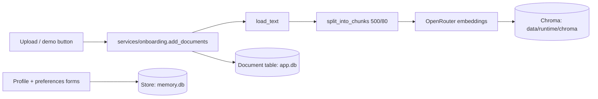

# Phase 2: Knowledge base and memory

## What I built (plain English, 3–5 sentences)
The user can now teach the app about themselves. A 3-step wizard asks for their profile (name,
target roles, languages, work authorisation…), their documents, and how their letters should
sound. Documents are cut into ~500-character chunks, turned into vectors, and saved in a local
Chroma database, so we can later find the exact paragraph that proves a skill. The profile and
preferences go into long-term memory (a LangGraph Store), which survives restarts. A
"Use the demo persona" button loads Alex Novak's 4 documents in one click.

## Why it matters for the user
Every later feature depends on this. The fit analysis can only quote evidence that's in the
knowledge base, and red flags (like "needs German C1") are checked against the profile. The user
types their profile once instead of in every chat.

## Concepts used
- [RAG](../CONCEPTS.md#rag-retrieval-augmented-generation): load → chunk → embed → store → retrieve
- [Embeddings and vector search](../CONCEPTS.md#embeddings-and-vector-search)
- [Short-term vs. long-term memory](../CONCEPTS.md#short-term-vs-long-term-memory): this phase builds the long-term part (Store, namespaces)

## Files created or changed
| File | Purpose |
|---|---|
| `app/rag/ingest.py` | Load PDF/DOCX/MD/TXT, chunk (500/80), embed, save to Chroma; re-upload replaces chunks |
| `app/rag/retriever.py` | `search_evidence()` → `list[Evidence]` with snippet, file name and 0–1 relevance |
| `app/memory/store.py` | Profile, preferences, facts and style rules on a `SqliteStore` (`data/runtime/memory.db`) |
| `app/agent/state.py` | First models from §5.1: `Evidence`, `StyleRule` (the rest come in Phase 3) |
| `app/agent/llm.py` | New `get_embeddings()` (OpenRouter, `openai/text-embedding-3-small`) |
| `app/services/onboarding.py` | What the wizard calls: add documents, load the demo persona, knowledge-base summary |
| `app/ui/pages/0_onboarding.py` | The 3-step wizard |
| `app/main.py` | Wizard is the home page until a profile exists; profile name in the sidebar |
| `app/config.py`, `app/utils/errors.py` | Chroma/memory paths; `DocumentError` for bad uploads |
| `pyproject.toml` | Added `langchain-text-splitters` (approved) |
| `tests/fakes.py` | Offline "keyword" embeddings so tests are free and repeatable |
| `tests/test_rag.py`, `tests/test_memory_store.py`, `tests/test_onboarding_service.py` | New tests (23) |
| `tests/conftest.py`, `tests/test_app_smoke.py` | Tests now always use a temporary runtime folder; smoke tests for both first pages |
| `docs/CONCEPTS.md` | New: RAG, embeddings, short- vs. long-term memory |

## How it works

1. The wizard saves the profile to the Store under `("local", "profile")`.
2. Each uploaded file is checked (type, ≤ 5 MB, ≤ 10 files, has text), then chunked. Each chunk
   gets metadata: `doc_name`, `doc_type` (guessed from the file name) and `chunk_id` such as
   `alex_novak_cv.md#4`.
3. Old chunks of the same file are deleted, and the new ones are embedded and added. The
   `Document` table records the file name and chunk count, so the summary works without an API call.
4. One bad file doesn't stop the others; its problem is shown next to it.
5. Later phases call `search_evidence("RAG chatbot")` and get back the best chunks with
   relevance scores.

## How to try it
```bash
uv run pytest                     # 40 offline tests
uv run pytest -m live             # 1 test with real embeddings (needs OPENROUTER_API_KEY)
uv run streamlit run app/main.py
```
1. With no profile yet, the app opens on **Get started**.
2. Click **✨ Fill in the demo persona**, then **Save and continue**.
3. Click **🧪 Use the demo persona**. You should see 4 files added (about 21 chunks).
4. Click **Continue**, choose a tone, and click **Finish setup**. You should see
   "Your knowledge base: 21 chunks from 4 documents ✔".
5. Stop the app (Ctrl+C) and start it again. It now opens on the Board with "👤 Alex Novak" in
   the sidebar.

Try a search by hand:
```bash
uv run python -c "
from app.rag.retriever import search_evidence
for e in search_evidence('RAG chatbot', k=3): print(round(e.relevance, 2), e.doc_name)
"
```
Expected: `project_documind_readme.md` first.

To start over, delete `data/runtime/` (keep `.gitkeep`).

## Decisions and alternatives
See `docs/DECISIONS.md` D9–D13: namespaces start with the user id, re-upload = delete and then
add with stable chunk ids, doc type guessed from the file name, fake embeddings in tests, and a
service layer for onboarding.

## Problems I hit and how I solved them
- **OpenRouter embeddings:** the OpenAI client checks text length with OpenAI's tokenizer, which
  doesn't know the id `openai/text-embedding-3-small`. I set `check_embedding_ctx_length=False`.
  Our chunks are tiny, so the check isn't needed. A real call returned 1,536-number vectors.
- **`store.search()` returns only 10 items by default.** Listing facts would have silently cut
  off at 10, so I pass `limit=1000`.
- **Tests were writing the log file into the real `data/runtime/`.** `tests/conftest.py` now
  sets `RUNTIME_DIR` to a temporary folder before any app code is imported.
- **The CV also mentions "RAG chatbot".** With the offline fake embeddings, the CV and the
  project README compete for the top spot. The offline test checks that the README is in the top
  4. The live test (real embeddings) checks that it is first, and it is.

## Possible review questions
- **Why chunk size 500 with overlap 80?** 500 characters is about one paragraph or 3–4 CV
  bullets: precise enough to be good evidence, big enough to keep context. The overlap keeps
  sentences that cross a border.
- **What happens if I upload my CV again?** Its old chunks are deleted first, then the new ones
  are added with ids like `cv.md#0`, `cv.md#1`… so nothing old is left behind.
- **Store vs. checkpointer?** The Store remembers the user across all jobs and chats
  (profile, preferences). The checkpointer (Phase 3) remembers where one job's workflow stopped.
- **Is my CV sent anywhere?** The text of each chunk is sent to OpenRouter once, to create the
  embedding. The vectors and the text are stored only on your computer.
- **How do you test RAG without paying for API calls?** `tests/fakes.py` has a keyword-based
  fake embedding model: free, offline and repeatable. One test marked `live` uses the real model.
