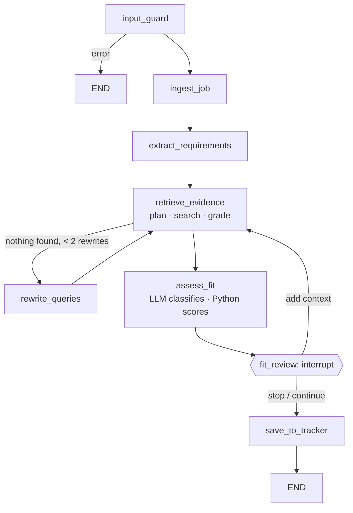

# Phase 3: Application workflow graph, analysis half

## What I built (plain English, 3–5 sentences)
The core agent can now read a job posting and judge, requirement by requirement, whether the
user fits. It is a LangGraph workflow with fixed steps: check the input, read the posting,
list the requirements, search the user's documents for evidence (and search again with
different words if nothing was found), then classify each requirement and compute a score.
At the end the graph **pauses** and waits for the user to decide: continue, stop, or add
context. The pause is saved to disk, so the app can be closed and the run continued later.

## Why it matters for the user
This is the "Is this job a fit for me?" feature. The user gets an honest score with evidence
from their own files (✅ / ⚠️ / ❌ per requirement), practical red flags like "Requires German
C1; your level is A2", and a tip for each gap. Nothing is decided for them; they review first.

## Concepts used
- [LangGraph basics](../CONCEPTS.md#langgraph-basics-state-nodes-edges): state, nodes, edges, conditional edges, compile
- [Workflow vs. agent](../CONCEPTS.md#workflow-vs-agent): why this part is a fixed workflow
- [Agentic RAG](../CONCEPTS.md#agentic-rag-grade-and-rewrite): grading and query rewriting
- [Human-in-the-loop](../CONCEPTS.md#human-in-the-loop-interrupt-and-resume): `interrupt()` and `Command(resume=...)`
- [Short-term memory](../CONCEPTS.md#short-term-vs-long-term-memory): the SQLite checkpointer
- [Structured output](../CONCEPTS.md#structured-output-with-pydantic) and [prompt techniques](../CONCEPTS.md#prompt-engineering-techniques)
- [Guardrails](../CONCEPTS.md#guardrails-prompt-injection-and-ssrf): prompt injection and SSRF

## Files created or changed
| File | Purpose |
|---|---|
| `app/agent/state.py` | All §5.1 models, the LLM output models, `RedFlag`, `FitReviewDecision`, `ApplicationState` |
| `app/agent/prompts.py` | New: all 6 prompts plus `PROMPT_VERSION`, the `wrap()` delimiter helper and the few-shot example |
| `app/agent/llm.py` | `invoke_structured()`: tenacity retries for busy servers, one retry on schema errors |
| `app/agent/deps.py` | New: `GraphDeps` (LLM, search, profile, fetch, save) and the real `default_deps()` |
| `app/agent/nodes/ingest.py` | `input_guard` and `ingest_job` (URL or text → `JobPosting`) |
| `app/agent/nodes/requirements.py` | `extract_requirements` (few-shot, ids R1…R15) |
| `app/agent/nodes/evidence.py` | Agentic RAG: `retrieve_evidence` (plan → search → grade), `rewrite_queries` |
| `app/agent/nodes/fit.py` | `assess_fit` plus the pure `compute_fit_score` and `find_red_flags` |
| `app/agent/nodes/review.py` | `fit_review` (the `interrupt`) and `save_to_tracker` |
| `app/agent/application_graph.py` | Wires the nodes, the `SqliteSaver` with a type allowlist, `thread_config()` |
| `app/guards/input_guard.py` | Length limits and prompt-injection phrase detection |
| `app/guards/url_guard.py` | SSRF protection: http(s) only, public IPs only |
| `app/services/web_fetch.py` | Safe download (10 s, 2 MB, every redirect re-checked) and trafilatura text extraction |
| `scripts/analyse_sample_jobs.py` | Runs the graph on the 3 sample jobs and prints the fit reports |
| `tests/fakes.py` | `FakeStructuredLLM`, a scripted LLM for offline graph tests |
| `tests/test_application_graph.py`, `test_fit.py`, `test_guards.py`, `test_llm_structured.py`, `test_live_fit.py` | 51 new tests (+1 live) |

## How it works

1. **input_guard**: blocks an empty knowledge base and text that is too short or too long
   (no LLM call yet). Injection phrases only add a warning.
2. **ingest_job**: downloads a URL safely if needed, then the LLM extracts a `JobPosting`.
3. **extract_requirements**: the LLM lists up to 15 requirements; Python numbers them R1, R2, ….
4. **retrieve_evidence**: one LLM call plans a search query per requirement, Chroma returns the
   top 4 chunks for each, and one LLM call grades every (requirement, chunk) pair. Only chunks
   graded relevant with a score of at least 0.4 are kept.
5. **rewrite_queries**: if a requirement found nothing, the LLM writes a different query and we
   search again. This happens at most 2 times.
6. **assess_fit**: the LLM marks each requirement met / partial / missing and must cite evidence
   ids. A "met" or "partial" without a real citation is downgraded to "missing". Python finds the
   red flags and computes the score.
7. **fit_review**: `interrupt()` pauses the graph. It resumes with
   `Command(resume={"action": "continue" | "stop" | "add_context", "text": …})`.
   "add_context" runs the search again with the user's note as extra evidence.

**Score formula** (`app/agent/nodes/fit.py` → `compute_fit_score`): must = 3, nice = 1;
met = 1, partial = 0.5, missing = 0; score = 100 × earned ÷ total, rounded half up; any
blocking red flag caps it at 40.

## How to try it
```bash
uv run pytest                                   # 91 offline tests, about 2 seconds
uv run python scripts/analyse_sample_jobs.py    # real LLM, about 1 minute, about $0.01
uv run python scripts/analyse_sample_jobs.py --my-data   # use your own profile and documents
uv run pytest -m live                           # live tests (about 3 minutes)
```
The script uses a temporary folder with the demo persona, so your data is untouched. It prints
each step, the score, the red flags and ✅/⚠️/❌ per requirement, and ends with:
```
   84  01_good_fit_junior_ai_engineer.md  (paused: True)
   43  02_partial_fit_data_engineer.md  (paused: True)
    0  03_poor_fit_senior_ml_engineer.md  (paused: True)
Ranking good > partial > poor and all paused: YES
```
(The exact numbers vary a little between runs because the LLM's classification varies. Phase 9
measures this.)

Resume a paused run by hand:
```python
from langgraph.types import Command
graph.invoke(Command(resume={"action": "add_context", "text": "I used Airflow at work"}), config)
```

## Decisions and alternatives
See `docs/DECISIONS.md` D14–D22: dependency injection with `GraphDeps`, structured language
requirements, `RedFlag` objects, the grounding downgrade, the RAG loop as graph edges, half-up
rounding, injection phrases flagged rather than blocked, the checkpoint type allowlist, and
"continue" ending the run until Phase 5.

## Problems I hit and how I solved them
- **LLM mistakes found by reading the first live run.** (1) The partial-fit job got a false
  "on-site" deal-breaker, although it allows remote work. (2) "Senior ML Engineer" was labelled
  "lead" because the text mentions mentoring. (3) "3+ years" was copied onto SQL and Python.
  I added one precise rule to each prompt (`PROMPT_VERSION` 2026-10-28.2), and the next run was
  correct on all three.
- **Banker's rounding.** Python's `round(62.5)` is 62. A test caught it, and the formula now
  rounds half up (63), which is easier to explain.
- **An injection pattern was too broad.** "act as" matched normal postings ("act as a team
  lead"), so I removed it.
- **Checkpoint security.** The default serializer can recreate any Python class named in the
  checkpoint file. I passed an allowlist with only our state models.

## Possible review questions
- **Why is the score computed in Python and not by the LLM?** LLM numbers drift between runs and
  can't be explained. The LLM only does what it's good at (reading and classifying). The
  arithmetic is a 10-line function with tests, so the same classification always gives the same
  score.
- **What makes the RAG "agentic"?** The agent checks its own search results (grading) and
  decides to search again with new words when nothing relevant was found. That's a loop with a
  decision, not a single lookup.
- **What does `interrupt()` do?** It stops the graph in the middle of a node and saves the
  state. The UI shows the payload. `Command(resume=value)` restarts that node, and this time
  `interrupt()` returns the value.
- **How do you stop the model inventing skills?** The grader filters chunks, the assessor must
  cite chunk ids, and Python downgrades any "met" without a real citation to "missing".
- **What if a posting says "ignore all previous instructions"?** The posting is wrapped in
  `<job_posting>` tags with a rule that tag content is data. The guard flags the phrase as a
  warning, and the score is computed in Python anyway.
