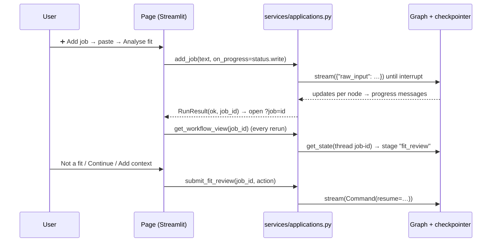

# Phase 4: Board and Job workspace (Fit tab)

## What I built (plain English, 3–5 sentences)
The fit analysis now has a user interface. The **Board** shows every job as a card in five
columns (Saved, Applied, Interview, Offer, Rejected), with its fit score and a badge when it
waits for your review. **➕ Add job** opens a dialog where you paste a posting or a link (or pick
a sample job). The analysis runs with live progress messages, then opens the **Job workspace**.
Its **Fit tab** shows the score, red flags and each requirement with its evidence, plus three
buttons that resume the paused graph: Continue, Not a fit, and Add context. Refreshing the
browser shows the same step again, because the page reads the saved graph state every time.

## Why it matters for the user
This is the first feature a real user can use from start to finish: "Is this job a fit for me?"
They see why (evidence quotes from their own files), what's risky (red flags), and how to talk
about gaps honestly. They also keep every job organised on one board.

## Concepts used
- [Human-in-the-loop with Streamlit reruns](../CONCEPTS.md#human-in-the-loop-with-streamlit-reruns): the interrupt-rendering pattern
- [Human-in-the-loop: interrupt and resume](../CONCEPTS.md#human-in-the-loop-interrupt-and-resume)
- [LangGraph `stream`](../CONCEPTS.md#langgraph-basics-state-nodes-edges): progress messages after each node
- [Short-term memory](../CONCEPTS.md#short-term-vs-long-term-memory): the checkpointer, keyed by `thread_id = job-<id>`

## Files created or changed
| File | Purpose |
|---|---|
| `app/services/applications.py` | New: add a job and run the analysis, read the workflow stage, resume the fit review, retry, board data, status change, delete |
| `app/ui/pages/1_board.py` | The board: 5 columns, job cards, status select boxes, the "➕ Add job" dialog with `st.status` progress |
| `app/ui/pages/2_job_workspace.py` | Job picker, status, delete, tabs; the Fit tab renders by stage and resumes the graph |
| `app/ui/components.py` | Fit card, score and stage badges, status labels |
| `app/ui/state.py` | New: the open job lives in the URL (`?job=3`), so a refresh keeps it |
| `app/agent/deps.py`, `app/agent/llm.py` | The graph can be built without an API key (to show saved results); a run then raises `ConfigError` |
| `tests/graph_fakes.py` | New: shared offline "world" (scripted LLM and search) used by graph, service and UI tests |
| `tests/test_applications_service.py` | 9 service tests: happy path, rejected input, no key, outage + retry, review actions, board |
| `tests/test_ui_pages.py` | 7 headless UI tests: empty board, dialog, card badges, fit card, refresh, both review buttons |

## How it works

1. **Add job**: `add_job()` creates the `Job` row first (so it has an id and a
   `thread_id = job-<id>`), then streams the graph. Each finished node becomes one line in the
   `st.status` box ("Extracted 8 requirements", "Scored the fit: 84/100").
2. **Bad input** (too short, not a posting, unreadable link): the card is removed again and the
   dialog shows why, so the user can fix the text. **Technical failure** (AI service down): the
   card stays with "⏳ analysis not finished", and **Retry analysis** continues from the last
   saved step.
3. **Render by stage**: on every rerun, `get_workflow_view()` reads `graph.get_state()` and
   returns one of `not_started`, `interrupted`, `fit_review`, `failed` or `finished`. The Fit
   tab draws the matching view.
4. **Resume**: a button calls `submit_fit_review()`, which checks the job is really waiting,
   validates the action, streams `Command(resume=…)`, and copies the new score to the board card.
5. **Refresh**: the job id is in the URL, and the state is in SQLite, so nothing is lost.

## How to try it
```bash
uv run pytest                      # 107 offline tests
uv run streamlit run app/main.py
```
1. If you haven't onboarded, use **Get started** with the demo persona (Phase 2).
2. On the **Board**, click **➕ Add job**, choose **Good fit: Junior AI Engineer**, and click
   **Analyse fit**. Watch the steps appear (about 15–30 seconds).
3. The **Job workspace** opens on the Fit tab: score, ✅/⚠️/❌ requirements, and expanders with
   evidence quotes and tips.
4. **Refresh the browser (F5)**: the same fit card is still there.
5. Open **➕ Add context and re-check**, type e.g. *"I write German emails to customers
   daily"*, and click **Re-check**. The score updates.
6. Click **🚫 Not a fit** or **Continue to application**. Back on the Board, the card shows its
   score; change its column with the select box.
7. Try the **Poor fit** sample: you'll see the ⛔ German C1 blocking red flag and a score of 40 or
   lower.

## Decisions and alternatives
See `docs/DECISIONS.md` D23–D28: the job id in the URL, a service layer for the workflow,
remove-on-bad-input vs. keep-on-outage, the graph without a key, the dialog's open state in
`session_state`, and the board reading graph state per card.

## Problems I hit and how I solved them
- **Refresh lost the open job.** `st.session_state` is empty after a browser refresh, so the job
  id now lives in the URL (`st.query_params`), and `st.switch_page(..., query_params=…)` sets it.
- **The dialog closed while typing in tests.** Streamlit's test runner doesn't emulate a
  dialog's partial reruns. Keeping "dialog open" in `session_state` (closed by `on_dismiss` or
  on success) works in both the browser and the tests.
- **The board crashed without an API key**, because building the graph created the LLM client.
  Now the graph is built with `llm=None`, so saved analyses can be shown, and starting a run
  gives the friendly "API key missing" message.
- **The no-key test used my real key.** pydantic-settings falls back to `.env` when the
  environment variable is empty, so the test removes the key on the settings object itself.

## Possible review questions
- **How does `interrupt()` work with Streamlit, which reruns the whole script on every
  click?** The graph's state is saved in SQLite under `job-<id>`. Every rerun asks the
  checkpointer where the run stands (`get_state`) and draws that step. A button resumes with
  `Command(resume=…)`. Nothing important lives only in Streamlit's memory.
- **What happens if I refresh during the fit review?** The URL keeps `?job=<id>`, the
  checkpointer keeps the paused state, and the Fit tab draws the same card and buttons.
- **What if the AI service fails halfway through?** The steps that finished are saved. The card
  shows "analysis not finished", and **Retry analysis** continues from the last saved step. A
  test checks that the posting isn't extracted a second time.
- **Why is there a service layer between the pages and the graph?** Pages only draw widgets.
  The workflow logic (create the row, stream, decide the stage, resume, sync the score) is
  plain Python with 9 tests, with no browser needed.
