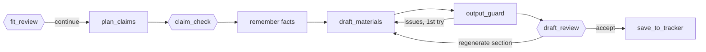

# Phase 5: Claim check, drafting, export

## What I built (plain English, 3–5 sentences)
After **Continue to application**, the agent proposes 4–8 **claims** about you for this job,
each with the evidence behind it. On the **Claim check** tab you keep, reword or drop each one;
claims without evidence start unticked. The agent then writes **CV bullets and a cover letter
from the kept claims only**. A second AI call, the **output guard**, fact-checks the drafts; if
it finds a statement no claim backs, the draft is rewritten once, and anything left over is
highlighted. On the **Documents** tab you edit the drafts, regenerate one section, rate them,
export a **DOCX** or copy the text. Every version is saved and listed on the new **Notes** tab.

## Why it matters for the user
This is the project's main promise: an application that sounds tailored but never claims
experience you don't have. The user stays in control at every step. They decide what may be
said, they see what the fact-checker doubts, and they accept the final text. Facts they vouch
for are remembered, so the next application asks fewer questions.

## Concepts used
- [Stopping invented experience: claim check and output guard](../CONCEPTS.md#stopping-invented-experience-claim-check-and-output-guard)
- [Three pauses in one workflow](../CONCEPTS.md#three-pauses-in-one-workflow)
- [Human-in-the-loop with Streamlit reruns](../CONCEPTS.md#human-in-the-loop-with-streamlit-reruns): now for three review types
- [Long-term memory](../CONCEPTS.md#short-term-vs-long-term-memory): confirmed facts and style rules from the Store
- [Structured output](../CONCEPTS.md#structured-output-with-pydantic): `ClaimPlan`, `Drafts`, `GuardReport`

## Files created or changed
| File | Purpose |
|---|---|
| `app/agent/nodes/claims.py` | New: `plan_claims` (claims + evidence check), `claim_check` (pause), `remember_confirmed_facts` |
| `app/agent/nodes/drafting.py` | New: `draft_materials`, `output_guard` (+ Python safety net), `draft_review` (pause) |
| `app/agent/application_graph.py` | "Continue" → claims → drafts; guard and regenerate loops |
| `app/agent/prompts.py` | 3 new prompts: claim planner, draft writer (tone, length, language, style rules), output guard |
| `app/agent/state.py` | `PlannedClaim`, `ClaimPlan`, `GuardReport`, the 2 new resume models, new state fields |
| `app/agent/deps.py` | Facts, style rules and draft saving are injected like the other services |
| `app/agent/nodes/review.py` | `save_to_tracker` also saves the accepted, edited draft |
| `app/agent/nodes/evidence.py`, `app/agent/llm.py` | Fix: grading in batches of 20; a cut-off answer becomes a friendly error |
| `app/services/applications.py` | Stages `claim_check` / `draft_review`, `submit_claim_review`, `submit_draft_review`, versions, ratings, export, notes |
| `app/services/export.py` | New: DOCX export with a `.txt` fallback |
| `app/ui/pages/2_job_workspace.py` | Claim check, Documents and Notes tabs; opens the tab that waits for you |
| `app/ui/components.py` | Claim badges, the reviewed-claims list, the fact-check box; new board badges |
| `tests/test_drafting_graph.py` | New: 13 graph tests (only approved claims reach the writer, guard + rewrite, regenerate, versions, memory) |
| `tests/test_export.py` | New: DOCX content and the `.txt` fallback |
| `tests/test_live_drafting.py` | New, live: full flow to a DOCX; the real guard catches an invented claim |
| `tests/graph_fakes.py`, others | Fake claim planner, writer and fact-checker; service, UI and batching tests |

## How it works

1. **Plan claims.** The LLM gets the requirements (with met/partial/missing), the fit evidence
   and earlier confirmed facts, and proposes claims with evidence ids. Python keeps only ids that
   exist; a claim with none is "no evidence in your documents".
2. **Claim check** (pause). The tab shows each claim with a tick box, an editable text and its
   evidence. Submit sends `{"decisions": [...]}`; anything not ticked is removed.
3. **Remember.** Kept claims without evidence, and reworded ones, go to the Store as facts.
4. **Draft.** The writer sees the posting, the **approved** claims, the profile basics, the gaps
   (with the honest tips) and the style: tone, letter length, language and learned style rules.
5. **Guard.** A second call lists unbacked statements, and Python adds any removed claim's exact
   wording. Problems on the first try → one rewrite with the list; otherwise → the user. The
   draft is saved as a version.
6. **Draft review** (pause). Edit, regenerate one section (the other stays as it is), export,
   copy, rate. **Accept & save** ends the run, and an edited version is saved if you changed
   anything. After that you can still edit; each save is a new version.

## How to try it
```bash
uv run pytest                          # 131 offline tests
uv run pytest -m live                  # 4 live tests incl. the full flow to a DOCX (~$0.02)
uv run streamlit run app/main.py
```
1. Onboard with the demo persona if needed, then add **Good fit: Junior AI Engineer** on the
   Board.
2. On the Fit tab, click **Continue to application ▶**. The **✅ Claim check** tab opens.
3. Untick one claim (e.g. the DocuMind RAG chatbot), reword another, and click **Confirm claims
   and write drafts ▶**. Watch the steps: "Wrote the drafts", "Fact check passed…".
4. On **📝 Documents**: check that the unticked claim isn't in the letter. Edit a sentence, try
   **🔄 Regenerate a section** → Cover letter → "shorter".
5. Click **⬇️ Export DOCX** and open the file. Try **📋 Copy as text** and the 👍/👎 ratings.
6. Click **✅ Accept & save**. Press **F5**: you see the accepted drafts. Open **🗒️ Notes** to
   see the versions, and add a next action; it appears on the board card.

## Decisions and alternatives
See `docs/DECISIONS.md` D29–D37: Python decides "supported"; undecided = removed; which facts
are remembered; the guard (LLM + Python, 2 attempts, then highlight); regenerate per section;
draft versions; the user's instruction isn't wrapped as data; grading batches; small model
additions.

## Problems I hit and how I solved them
- **The writer turned claims into new skills.** In a live run, "processed documents into
  chunks" became "equipped me with the skills to design RAG pipelines", and the guard let it
  pass. Both prompts now say that skills concluded from a claim are claims too. In the next run
  the guard flagged 2 statements, and the rewrite removed them.
- **A Phase 3 bug surfaced: the grading answer was cut off.** With 15 requirements, one grading
  call needed more than the 1,500-token limit, and `LengthFinishReasonError` reached the user.
  Grading now runs in batches of 20 pairs, and a cut-off answer becomes a friendly error (D36).
- **The live drafting test was too strict.** It demanded zero guard issues, but highlighting
  leftovers after one rewrite is the designed outcome. The test now checks the real promise:
  the removed claim's wording isn't in the drafts.
- **Form widgets in `AppTest`.** Values typed into an `st.form` are only sent on submit, so the
  test sets them and clicks submit without a rerun in between.

## Possible review questions
- **How do you make sure a removed claim never appears in the letter?** The writer never sees
  it: `claims_block()` only includes approved claims, and a test asserts the removed text isn't
  in any drafting prompt. The guard is also told about removed claims, and Python flags their
  exact wording.
- **Why a second LLM call to check the first?** Prompt rules reduce invention but don't
  guarantee it. An independent checker with only the approved claims catches inflated
  statements. Max 2 attempts keeps the cost predictable, and the user judges what's left.
- **What happens to a claim the user keeps but the documents don't show?** It's saved as a
  confirmed fact in the Store (`("local", "facts")`). Next time it counts as evidence, labelled
  "Fact you confirmed earlier".
- **How does "regenerate" avoid losing my edits?** The page sends your current text with the
  request. Python keeps the section you didn't regenerate exactly as it was, and the guard only
  checks the new section.
- **Where are drafts stored?** Each version is a row in the `Draft` table (AI draft or your
  edit). The workflow state is in the checkpointer; after acceptance the table is the record.
