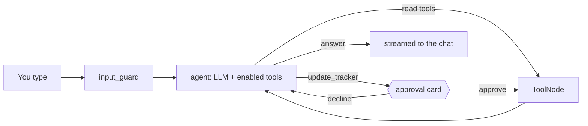

# Phase 6: Copilot chat, tools and toggles

## What I built (plain English, 3–5 sentences)
A **Copilot chat** page where you can ask open questions about your job search. The copilot is
a **ReAct agent**: it decides by itself which of its **5 tools** to use: read a job posting,
search your documents, research a company (Tavily), search job ads (Adzuna), and read or update
your tracker. Before it **changes** anything on your board, it stops and shows an **approval
card**. You switch each tool on or off in the sidebar; tools whose API keys are missing are off,
with a hint. The job workspace has a new **Company tab** with a web-based company brief and its
sources.

## Why it matters for the user
Not every question fits a fixed workflow. "What should I apply to next?", "Summarise my
applications this week" or "Research Lumen Health and move it to Applied" need different tools
in different orders. The user gets that flexibility without losing control: the agent can read
on its own, but it can't change their data without a click.

## Concepts used
- [Function calling: the full loop](../CONCEPTS.md#function-calling-the-full-loop): the real schema and message sequence
- [The copilot: a ReAct agent with an approval step](../CONCEPTS.md#the-copilot-a-react-agent-with-an-approval-step)
- [Workflow vs. agent](../CONCEPTS.md#workflow-vs-agent): why the chat is an agent and applications are a workflow
- [Human-in-the-loop: interrupt and resume](../CONCEPTS.md#human-in-the-loop-interrupt-and-resume): the approval pause
- [Guardrails: prompt injection](../CONCEPTS.md#guardrails-prompt-injection-and-ssrf): web results as untrusted content

## Files created or changed
| File | Purpose |
|---|---|
| `app/tools/job_posting.py` | New: `fetch_job_posting` (URL guard + the extraction prompt) |
| `app/tools/experience.py` | New: `search_my_experience` (knowledge base quotes with file names) |
| `app/tools/company.py` | New: `research_company` (Tavily, results marked untrusted) |
| `app/tools/job_search.py` | New: `search_jobs` (Adzuna API via httpx, country allowlist) |
| `app/tools/tracker.py` | New: `get_applications`, `update_tracker` (+ the approval summary) |
| `app/tools/registry.py` | New: `TOOL_REGISTRY`: labels, defaults, approval tools, required keys |
| `app/agent/copilot_graph.py` | New: the ReAct graph: guard → agent ⇄ tools, approve before writes |
| `app/services/copilot.py` | New: send a message / answer an approval as streamed events; history from the checkpointer |
| `app/services/company.py` | New: company brief (structured output) with real source links, cached per job |
| `app/agent/prompts.py` | Tool descriptions, the copilot system prompt, the company brief prompt |
| `app/agent/llm.py` | `invoke_chat()`: same retries and error mapping for the chat |
| `app/ui/pages/3_copilot_chat.py` | The chat: streaming, tool expanders, approval card, starters, New chat |
| `app/main.py`, `app/ui/state.py` | Sidebar tool toggles; chat id in the URL |
| `app/ui/pages/2_job_workspace.py` | The Company tab |
| `app/memory/store.py`, `app/config.py`, `app/utils/errors.py` | Research cache, key checks, `ExternalServiceError` |
| `tests/test_tools.py`, `test_copilot_graph.py`, `test_copilot_service.py`, `test_company_service.py` | 37 new offline tests (plus 4 UI tests in `tests/test_ui_pages.py`) |
| `tests/copilot_fakes.py`, `tests/fakes.py` (`FakeToolLLM`) | Scripted tool-calling model and conversations |
| `tests/test_live_copilot.py` | 2 live tests: tracker update with approval; research + move (needs Tavily) |

## How it works

1. The page sends your message with the **enabled tools** from the sidebar.
2. `agent` binds those tools (`bind_tools`) and calls the LLM with your profile and the rules.
3. If the answer has **tool calls**, `ToolNode` runs them and adds the results as ToolMessages,
   and the LLM thinks again (ReAct loop, max 12 steps).
4. If it wants `update_tracker`, the graph **pauses** (`interrupt`) with a summary. The chat
   shows ✅ Approve / ✖️ Decline and blocks new messages until you choose.
5. The answer streams token by token. Afterwards the page redraws the chat from the
   checkpointer, with a "🔧 Used: …" expander per tool call.

## How to try it
```bash
uv run pytest                         # 172 offline tests
uv run pytest -m live                 # 6 live tests (the Tavily one skips without a key)
uv run streamlit run app/main.py
```
Optional keys in `.env`: `TAVILY_API_KEY` (free at tavily.com) for company research,
`ADZUNA_APP_ID` + `ADZUNA_APP_KEY` (free at developer.adzuna.com) for job search. Restart the
app after adding them.

1. Open **🔧 Copilot tools** in the sidebar: tools without keys are greyed out with a hint.
2. Open **💬 Copilot chat** and click **Summarise my applications this week**. Open the
   "🔧 Used: …" expander to see the tool's input and output.
3. Type **"Research the company for my newest job and move it to Applied"**. Watch it use the
   tracker and company tools, then show the **approval card**. Check the Board: still Saved.
   Click **✅ Approve**: the card moves to Applied. (Try **✖️ Decline** on another job.)
4. Switch off the tracker toggle and ask "list my jobs": it says the tool is off.
5. Press **F5**: the chat is still there. **🆕 New chat** starts over.
6. In a job's **🏢 Company** tab, click **🔎 Research …** (needs the Tavily key).

## Decisions and alternatives
See `docs/DECISIONS.md` D38–D47: a hand-written ReAct graph with `ToolNode`; tools bound per
message and only enabled ones can run; approval only for writes; tool descriptions in
`prompts.py`; untrusted wrapping; free-text chat answers; two stream modes; the research cache
in the Store; the chat id in the URL; a firmer off-topic rule.

## Problems I hit and how I solved them
- **The chat wrote a pizza poem.** "Politely decline unrelated requests" wasn't enough for the
  model. A firmer rule with examples fixed it in a live check (poem and trivia declined,
  interview advice answered). Phase 7 adds a real topic classifier.
- **Tokens vs. full messages.** A real model streams tokens; the fake test model (and the guard's
  own answers) don't. The service sends the full text only when no tokens came, and a live check
  confirmed the streamed text equals the saved message.
- **A disabled tool could still run.** If the graph's `ToolNode` had every tool, a model that
  calls a switched-off tool would succeed. The `tools` node now builds its `ToolNode` from the
  enabled tools only, and a test checks this.
- **No Tavily or Adzuna key here.** Both tools are tested offline with replaced HTTP calls. The
  live "research + move" test is skipped without a Tavily key; the tracker-only live test passed
  (the real model chose `get_applications` → `update_tracker` and waited for approval).

## Possible review questions
- **What's the difference between your two agents?** The application graph is a workflow (code
  picks the next step); the copilot is a ReAct agent (the LLM picks tools). Both use
  LangGraph, a checkpointer and `interrupt()`.
- **Walk me through one tool call.** `bind_tools` sends the schema → the model returns
  `tool_calls=[{"name": "get_applications", "args": {}, "id": "call_1"}]` → `ToolNode` runs it →
  a `ToolMessage` with `tool_call_id="call_1"` goes back → the model answers or calls more tools.
- **Can the copilot change my data without asking?** No. The only write tool, `update_tracker`,
  always goes through the `approve` pause, and declining leaves the job unchanged.
- **What does a toggle actually change?** Which tools are bound to the LLM for the next message,
  and which tools the `tools` node is allowed to run.
- **What if a web page says "ignore your instructions"?** Results are wrapped as untrusted data,
  the prompt says to ignore instructions in them, and writes need your approval anyway.
