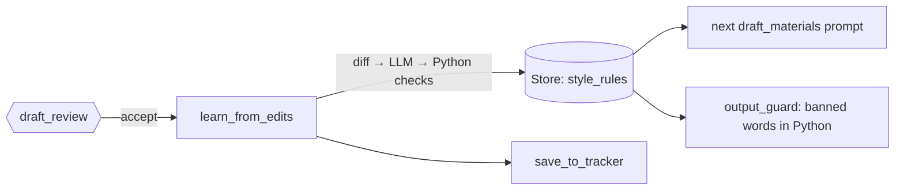

# Phase 8: Interactive extras

## What I built (plain English, 3–5 sentences)
Four extras that make the app feel personal. A **mock interview** on each job's **🎤 Interview
prep** tab: 5 questions built from the job's requirements, your gaps and the company research,
with a 1–5 score, a STAR check, one improvement and a better example answer made only from your
own documents. The app now **learns your writing style**: delete "passionate" from a letter and
it saves the rule "Avoid the word 'passionate'", follows it in every new letter, and checks for
the word in plain Python. A **tone selector** in the sidebar (formal, friendly, concise) changes
how letters, chat answers, interview feedback and the help-bot sound. The **❓ Help** page
explains the app in 4 steps, has a FAQ, and a **help-bot** that answers from the new user guide.

## Why it matters for the user
- They can practise for the interview for *this* job, including the awkward question about the
  skill they don't have yet, and get honest, concrete feedback.
- They fix a habit of the AI once instead of in every letter, and they can see and undo
  everything it learned.
- The app sounds the way they want, everywhere, from one setting.
- They can find out how something works without leaving the app.

## Concepts used
- [A loop agent: the mock interview](../CONCEPTS.md#a-loop-agent-the-mock-interview-phase-8) (new)
- [Learning from feedback](../CONCEPTS.md#learning-from-feedback-phase-8) (new)
- [When to use prompt engineering vs. RAG vs. agents](../CONCEPTS.md#when-to-use-prompt-engineering-vs-rag-vs-agents) (new)
- [Human-in-the-loop: interrupt and resume](../CONCEPTS.md#human-in-the-loop-interrupt-and-resume): one pause per interview round
- [Structured output with Pydantic](../CONCEPTS.md#structured-output-with-pydantic): `avoid_phrases` keeps machine-checkable words apart from the rule text
- [Short-term vs. long-term memory](../CONCEPTS.md#short-term-vs-long-term-memory): interviews in the checkpointer, style rules in the Store

## Files created or changed
| File | Purpose |
|---|---|
| `app/agent/interview_graph.py` | New: the interview loop (generate_question → ask → evaluate_answer → … → summarise), `InterviewDeps`, question plan, average score |
| `app/agent/nodes/learning.py` | New: `edit_diff()`, `propose_rules()`, `rules_from_feedback()`, `is_duplicate()`, the `learn_from_edits` node |
| `app/agent/application_graph.py` | `draft_review → learn_from_edits → save_to_tracker` |
| `app/agent/nodes/drafting.py` | `find_avoided_phrases()` in the output guard; style rules passed as objects |
| `app/agent/state.py` | `StyleRule.avoid_phrases`; `ProposedStyleRule`, `StyleRuleProposal`, `InterviewQuestion`, `AnswerFeedback`, `InterviewSummary`, `InterviewSetup`, `InterviewTurn`, `InterviewAnswer`, `InterviewState`, `HelpAnswer`; `learned_rules` in the state |
| `app/agent/prompts.py` | 6 new prompts (style learner, feedback learner, interview question, answer coach, interview summary, help-bot); fix note covers banned words; `PROMPT_VERSION` 2026-10-29.9 |
| `app/agent/deps.py` | `list_style_rules` returns `StyleRule`s; new `add_style_rule` |
| `app/services/interview.py` | New: build the interview from the fit analysis, start, answer, end early, retry, past interviews, rating |
| `app/services/learning.py` | New: learn from edits after acceptance and from repeated 👎 comments; still-saved rules; undo |
| `app/services/help.py` | New: the help-bot (whole guide in the prompt, real sections only) |
| `app/services/applications.py` | `learned_rules` in `WorkflowView`, progress line, deleting a job deletes its interview |
| `app/services/my_data.py`, `app/memory/store.py` | `set_tone()`, `add_style_rule()`; rewording a rule drops banned words it no longer mentions |
| `app/guards/input_guard.py` | `check_interview_answer()` |
| `app/db/repo.py` | `list_interview_sessions()` |
| `app/main.py`, `app/ui/state.py`, `app/ui/components.py` | 🎭 Tone selector in the sidebar; tone labels; `coming_soon()` removed (nothing is "coming soon" anymore) |
| `app/ui/pages/2_job_workspace.py` | Interview prep tab; "🧠 I learned…" box with ↩️ Undo; 👎 asks what was wrong; learning on 💾 Save changes |
| `app/ui/pages/4_memory.py` | Rule source ("learned from your edits · checks for: passionate") and ➕ Add rule |
| `app/ui/pages/5_help.py` | The Help page |
| `docs/USER_GUIDE.md` | New: getting started, the 4 use cases, learning, tone, privacy, costs, troubleshooting, FAQ (screenshots in Phase 10) |
| `tests/test_interview.py`, `test_learning.py`, `test_help.py`, `test_live_extras.py` | New tests (38 offline, 3 live) |
| `tests/graph_fakes.py`, `conftest.py`, `test_ui_pages.py` | Fake learner, interviewer and coach; interview graph in `fake_app`; 5 UI tests |

## How it works

1. **Learning:** at "Accept & save", `edit_diff()` lists the changed sentences. No change → no
   LLM call. Otherwise the LLM proposes 0–3 general rules with `avoid_phrases`; Python keeps
   only words you really deleted and drops duplicates; the rules go to the Store. The next
   draft's prompt lists them, and the output guard searches for the banned words.
2. **Interview:** the service builds an `InterviewSetup` from the saved fit analysis (gaps with
   their honest positioning) and the cached company research. The graph writes question 1 and
   pauses. Each answer resumes it: search your documents → feedback → next question → pause.
   After 5 answers (or "End interview now") it summarises and saves an `InterviewSession`.
3. **Tone:** the sidebar writes `Preferences.tone`; every prompt that talks to you reads it.
4. **Help:** the question passes the chat's Python guard, then one LLM call with the whole guide.

## How to try it
```bash
uv run pytest                                  # 281 offline tests
uv run pytest -m live tests/test_live_extras.py -s   # 3 live tests (~$0.02, ~3 minutes)
uv run streamlit run app/main.py
```
1. **Done when (learning):** add the good-fit sample job, **Continue**, confirm the claims,
   and **✅ Accept & save** the drafts. The real model rarely writes "passionate", so put it in
   yourself: in **📝 Documents**, add the sentence "I am passionate about building AI products."
   to the letter and click **💾 Save changes**. Now delete that sentence again and click
   **💾 Save changes**. A toast says "🧠 I learned: Avoid the word 'passionate'", and the box
   above the letter offers **↩️ Undo**. Add a second job and write its drafts: no "passionate".
   On **🧠 What I know about you → 📏 Style rules** the rule shows "learned from your edits ·
   checks for: passionate". (If the AI's own letter has a word you dislike, just delete it and
   click **✅ Accept & save**: the same learning runs at acceptance.)
2. **Ratings:** give the letter 👎 and write "too long". Do it again on another job ("still too
   long"). The second time, a rule like "Keep the letter under 200 words" appears.
3. **Interview:** on a job with a finished fit analysis, open **🎤 Interview prep** → **Start mock
   interview**. Answer a question in one line, then a better one with a result: compare the
   scores. Refresh the browser mid-interview: same question. **End interview now** → summary.
4. **Tone:** switch the sidebar to ✂️ Concise and ask the copilot or the help-bot something.
5. **Help:** open **❓ Help**, ask "How do I undo a learned rule?" and "What is the capital of
   Australia?" (the second says the guide doesn't cover it).

## Decisions and alternatives
See `docs/DECISIONS.md` D60–D68: the interview as its own graph with one thread per job; Python
chooses the question kind and the score; the improved answer only from your own evidence;
`avoid_phrases` checked in Python; a sentence diff; duplicate rules caught by string similarity
and learning that never blocks acceptance; ratings become a rule only when a complaint repeats;
the tone selector writes the saved preference; the help-bot stuffs the guide instead of RAG.

## Problems I hit and how I solved them
- **"The next letter doesn't use it" needed more than a prompt.** A rule in the prompt is
  usually followed, not always. The rule now carries `avoid_phrases` (structured output), and
  the output guard checks them in Python, so a slip is rewritten once and then highlighted.
- **The model learned the opposite of what I did.** In a live check I *added* a "passionate"
  sentence and saved; the model proposed "Avoid the word 'passionate'". Python had already
  removed the banned word, but the rule text stayed, and later blocked the right rule as a
  duplicate. Two causes: the prompt's example used "passionate" itself (priming), and nothing
  said that added text isn't something to avoid. Fixes: the example now uses "leverage", the
  prompt explains "-" vs "+" lines, and `_to_rules()` drops a rule whose banned words were never
  deleted. Re-checked 4 times with the real model: add → no rule; remove → "Avoid the word
  'passionate'".
- **A help-bot test reached the real API.** Setting `OPENROUTER_API_KEY=""` doesn't hide the key
  in `.env`. The test now patches the service's settings with `Settings(_env_file=None)`, the
  same way the config tests do. The learning service got a `get_model()` seam that `fake_app`
  replaces, so UI tests never call the network.
- **The live "done when" test needed a letter with "passionate" in it.** The real writer rarely
  uses the word. The test writes it into the AI's draft with `update_state(..., as_node=
  "output_guard")`, continues the run to the draft review, then removes it as the user would.
- **Not done:** the improved interview answer has no separate fact-check call (D62); the
  interview rating isn't learned from yet; screenshots in the user guide are Phase 10.

## Possible review questions
- **What's the third agent type?** The interview loop: code decides how many rounds and which
  kind of question; the LLM writes and assesses; the human answers every round.
- **How does learning from edits work?** Python diff → LLM proposes general rules with banned
  words → Python keeps only really deleted words and drops duplicates → Store → prompt + guard.
- **How do you know the rule works?** An offline test with a writer that follows rules, an
  offline test with a stubborn writer (rewritten, then highlighted), and a live test with the
  real model.
- **Why not RAG for the help-bot?** One ~2.5k-token document; stuffing is simpler, cheaper to
  build and always has the full context.
- **Can the interview coach make up achievements?** The prompt forbids it, it only gets your
  answer and your own chunks, and cited ids are filtered to real ones.
- **Where is the tone stored?** In the Store's preferences; the sidebar and the Memory page edit
  the same value.
