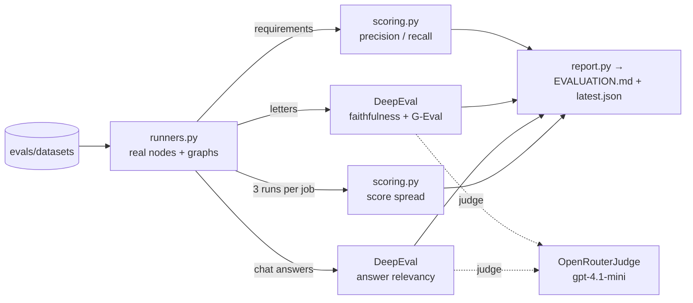

# Phase 9: Evaluation

## What I built (plain English, 3–5 sentences)
An evaluation suite in `evals/` that measures how good the AI parts of the app are, with one
command: `uv run python evals/run_evals.py`. It runs the **real** app code on fixed test data:
10 hand-labelled job postings, 5 cover-letter cases and 5 chat questions. It scores them with
plain Python where a right answer exists (requirements precision/recall, fit-score spread) and
with **DeepEval** where it takes judgement (faithfulness, answer relevancy, a G-Eval rubric). The
results are written into `docs/EVALUATION.md` together with a hand-written failure analysis.

## Why it matters for the user
- "The app doesn't invent experience" is now a number (faithfulness), not just a promise.
- We now know how stable the fit score is: clear fits and misfits move by a few points, but a
  partial fit moved 16 points across 3 runs (36–52). The ranking never changed. This is written
  down as the top improvement.
- The evaluation found real weaknesses the user would hit (the chat half-refusing to plan
  skills; "Python or TypeScript" counted as two must-haves). They are written down with fixes.

## Concepts used
- [Evaluation: plain checks and LLM-as-a-judge](../CONCEPTS.md#evaluation-plain-checks-and-llm-as-a-judge-phase-9) (new)
- [Stopping invented experience: claim check and output guard](../CONCEPTS.md#stopping-invented-experience-claim-check-and-output-guard): what faithfulness checks from the outside
- [Structured output with Pydantic](../CONCEPTS.md#structured-output-with-pydantic): the judge answers DeepEval's schemas
- [Observability with LangSmith](../CONCEPTS.md#observability-with-langsmith): eval runs are tagged `eval_*`

## Files created or changed
| File | Purpose |
|---|---|
| `evals/run_evals.py` | New: the command. Temp runtime folder, demo persona, the 4 parts, the report, the cost |
| `evals/runners.py` | New: runs `extract_requirements`, `draft_materials`, the copilot graph and the application graph on the datasets; DeepEval `measure()` wrapper that keeps the judge's verdicts |
| `evals/judge.py` | New: `OpenRouterJudge` (DeepEval model on our `get_llm()`), `make_metrics()`, `CANDIDATE_CLAIMS_PROMPT`, `TAILORING_STEPS`, thresholds |
| `evals/scoring.py` | New: label matching, precision/recall/F1, micro average, score spread, ranking check (pure Python) |
| `evals/report.py` | New: Markdown tables, writes between markers in `docs/EVALUATION.md`, JSON in `evals/results/latest.json` |
| `evals/data.py` | New: Pydantic loaders for the datasets |
| `evals/datasets/requirements_labels.json` | New: 10 postings, must-have labels with match keywords |
| `evals/datasets/postings/04…10_*.md` | New: 7 postings (German-language, prose-only, prompt injection, …) |
| `evals/datasets/drafting_cases.json` | New: 5 cases with approved claims, one tempting removed claim and gap notes |
| `evals/datasets/chat_questions.json` | New: 5 chat questions |
| `evals/test_faithfulness.py`, `evals/test_requirements_extraction.py`, `evals/conftest.py` | New: the same checks as live pass/fail tests (`uv run pytest evals -m live`) |
| `evals/results/latest.json` | New: raw results of the last run, including every letter and answer |
| `tests/test_evals.py` | New: 21 offline tests for the datasets, the maths, the runners, the judge adapter and the report |
| `docs/EVALUATION.md` | New: setup, metrics explained, targets, generated results, failure analysis, improvements, limits |
| `docs/DECISIONS.md` | D69–D74 |
| `docs/CONCEPTS.md`, `docs/GLOSSARY.md`, `docs/REVIEW_GUIDE.md`, `README.md` | Evaluation concept, 13 terms, 8 review Q&As + cheat sheet rows, the commands |

## How it works


1. `run_evals.py` sets `RUNTIME_DIR` to a new temp folder (before importing `app`) and loads the
   demo persona, so the user's data is never touched.
2. Each part runs production code: e.g. `draft_materials(state, deps)` with a state built from a
   drafting case, exactly as the graph would call it after a claim check.
3. DeepEval metrics run one at a time with `metric.measure(test_case)`; failures become an
   "error" row instead of stopping the run.
4. Every part is wrapped in `track_usage("eval_…")`, so the report shows what each part cost.
5. `write_report()` replaces only the text between the result markers.

## How to try it
```bash
uv run pytest tests/test_evals.py                   # offline, free, 21 tests
uv run python evals/run_evals.py --only extraction  # ~10 s, < $0.01
uv run python evals/run_evals.py                    # everything: ~12 min, ~$0.06
uv run pytest evals -m live                         # pass/fail version, ~2 min, ~$0.02
```
Then open `docs/EVALUATION.md` → §6 Results, and `evals/results/latest.json` to read the
letters and chat answers that were scored.

## Decisions and alternatives
- **D69** Run the real app code in a throwaway folder; call `metric.measure()` directly instead
  of DeepEval's test runner.
- **D70** The judge goes through our OpenRouter factory and is a different, stronger model.
- **D71** Faithfulness only checks facts about the candidate (custom claim prompt), with
  `penalize_ambiguous_claims=True`.
- **D72** Requirement labels are matched by keywords, not exact strings or an LLM.
- **D73** The fit-score check uses the production temperature.
- **D74** The report is generated between markers, the analysis is hand-written around it.

## Results in short (run 2, EVALUATION.md §6)
| Metric | Result | Target |
|---|---|---|
| Extraction precision / recall | 1.00 / 1.00 | ≥ 0.8 |
| Faithfulness (mean) | 0.89; only "borderline" flags, no invented experience | ≥ 0.9 per letter |
| Tailoring (G-Eval) | 0.84 | ≥ 0.6 |
| Removed claims leaked | 0/5 | 0 |
| Chat answer relevancy | 0.86 | ≥ 0.7 |
| Fit-score std dev | 1.4 / 6.5 / 4.2 (good / partial / poor) ❌ | ≤ 5 |

## Problems I hit and how I solved them
- **DeepEval only talks to OpenAI by default.** Wrote `OpenRouterJudge`, a small adapter
  implementing DeepEval's model interface on top of `get_llm()`. It asks for structured output
  and falls back to plain JSON text, which DeepEval parses itself.
- **Faithfulness was 0.48 for honest letters.** Reading the judge's reasons showed two causes:
  my context was missing the gap notes the writer is allowed to use, and DeepEval's default
  prompt treated "I'm excited to apply" as a factual claim. Fixed the context (0.58), then
  replaced the claim-extraction prompt through DeepEval's `evaluation_template` hook (0.88).
- **The judge's summary can be wrong.** One reason claimed a letter said "3+ years as a data
  engineer"; it didn't. `measure()` now keeps the per-statement verdicts, and the analysis
  quotes those.
- **My first G-Eval rubric punished honesty.** It penalised letters that "ignore" key
  requirements, so honest letters for partial-fit jobs lost points for not claiming Spark.
  Rewrote that step: naming a gap honestly is fine.
- **A too-loose label keyword.** "ship" (for "shipped software") matched "a background in
  shipping". Keywords must be specific within their posting.
- **DeepEval 4.3 builds its prompt classes from a bundle,** so `inspect.getsource` doesn't work
  and the template class can't be imported by name. Got it from the metric's default argument
  and subclassed it; `tests/test_evals.py` checks that DeepEval really uses our prompt.

## Possible review questions (with short answers)
- **Why DeepEval?** It's the course's evaluation library, its metrics are well known
  (faithfulness, relevancy, G-Eval), and it accepts a custom judge model.
- **Why not let the judge use the same model as the app?** Models rate their own writing higher
  (self-preference bias). `gpt-4.1-mini` judges `gpt-4o-mini`.
- **Isn't faithfulness with a custom prompt "grading your own homework"?** The prompt only
  decides *which sentences are checked* (facts about the candidate, not opinions); the
  checking itself is DeepEval's. It is stricter than the default on what matters:
  `penalize_ambiguous_claims=True` makes "not in the context" a fail.
- **How big is the variance of the fit score?** Good fit 91–94, poor fit 5–14, partial fit
  36–52 (std dev 6.5, above our target of 5). The ranking held in all 18 runs. Partial fits have
  many borderline requirements; one must-have flipping costs 6–12 points.
- **What would you do next?** Fix the "or" splitting in the extraction prompt, make the copilot
  search documents for questions about the user's own skills, add groundedness for chat, and
  run the evaluation on every `PROMPT_VERSION` change.
